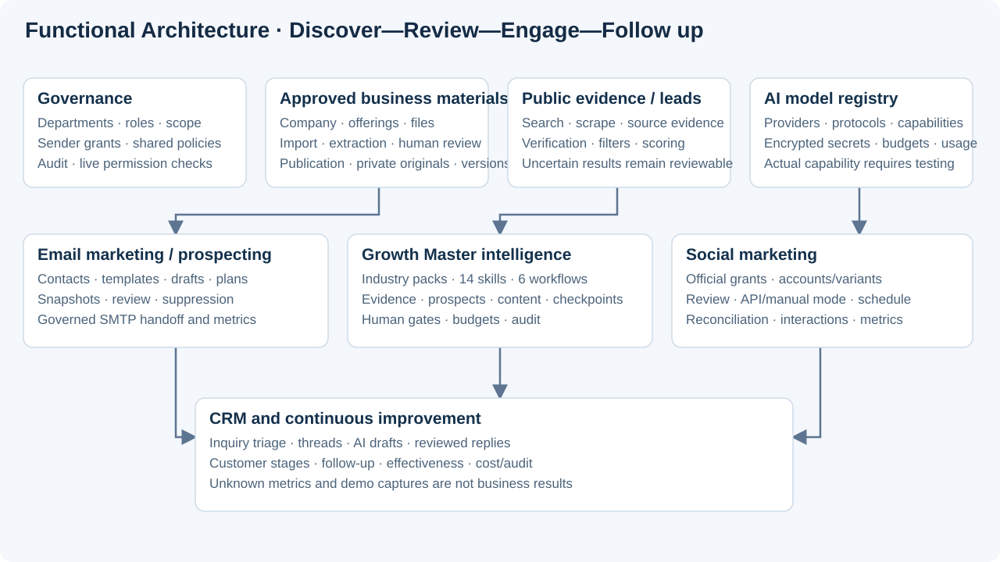

# Functional Architecture

**LeadPilot AI | Version 1.0 | 2026-11-14 | Source baseline `cf57fb3`**

## 1. Business lifecycle

The platform connects approved business materials → public evidence → candidate discovery → contact verification → content creation → review and controlled delivery → inbound processing → CRM follow-up and measurement. It does not guarantee transactions or automatically establish legal permission to market.

Source: [Mermaid functional diagram](../assets/diagrams/functional.mmd).

## 2. Domains and navigation

| Domain | Route / entry | Inputs and operations | Outputs and limits |
|---|---|---|---|
| Login / workspace | `/login`, `/workspace` | Account, department, roles, workbench tabs | Server-authorized functionality; administrator/member views can differ |
| Overview | `/overview` | Domain, period, mail logs/statistics | Delivery, open, click, bounce and queue metrics; distinguish coverage and unknown values |
| Organization | Workspace departments, members, roles, grants and policies | Department tree, role scope, operation permissions, sender grants | Data isolation, shared limits and audit; role permission is not mailbox authorization |
| Contacts | `/contacts` or workspace tabs | Groups, addresses, imports, filters, confirmation/subscription, tags | Audiences, import progress and review; discovery is not marketing consent |
| Templates / email | `/template`, `/market` or workspace | HTML/AI templates, audience, sender pool, subject, policies | Separate tasks, content snapshots, queue and reports; pause does not recall submitted mail |
| Schedules / automation | Workspace tabs, `/automation` | Once/daily/weekly/monthly, timezone, subscription-confirmed conditions | Separate runs; controlled sequential rules, not an arbitrary workflow canvas |
| Send API | `/send` | Authorized integration credentials, audience and templates | Governed delivery; cannot bypass scope or global limits |
| Materials | `/materials` | Company/brand facts, products, files, mapping, extraction and approval | Published facts, versions, private files and review rows |
| AI prospecting | `/outreach` | Approved company/products, markets, search, verification, sending policy | Candidates, leads, messages, inquiries and jobs; addresses must appear in real sources |
| Intelligence | `/intelligence` | Industry packs, skills, six workflows, quality thresholds and budgets | Evidence, prospect staging, approvals, checkpoints, cost and audit |
| Social marketing | `/social` | Official authorization, platform/market/language variants, review and schedule | Deliveries, manual reminders, calendar, interactions and metrics; platform constraints apply |
| CRM | `/crm` | Customers, synchronized mail, stages, follow-ups, AI drafts | Inquiries, replies and follow-up; a draft is not a sent reply |
| AI model registry | `/settings/ai-model`, module AI settings | Provider, protocol, capabilities, credentials and budgets | Unified options and encrypted secrets; saving settings does not prove a real call works |
| Mail foundation / operations | `/domain`, `/mailbox`, `/smtp`, `/logs`, `/settings` | DNS, mailboxes, SSL, relay, queue, containers and configuration | Mail services and diagnostics; privileged operations need administrator review |

These are source routes, not deployment-specific SafePath entries or published production URLs. Some administrator menus retain legacy pages while ordinary members use scoped workspace views. The User Manual emphasizes the unified workspace lifecycle.

## 3. Responsibilities and approval separation

| Responsibility | Suggested duties | Additional checks |
|---|---|---|
| System administrator | Accounts, departments, roles, grants, AI/platform setup, infrastructure | Least privilege, encryption key/backup, global limits |
| Materials maintainer | Business facts, imports, recognition and review | Human-edit protection, sensitive fields, internal/public separation |
| Content reviewer | Publish approved facts, review mail/social versions | Sources, locale, trademark/compliance, unsubscribe and commitments |
| Marketing operator | Audience, drafts, plans, content versions and monitoring | Sender/Page grants, window, budget and customer cooldown |
| Sales/support | CRM, inquiries, follow-ups and reviewed replies | Correct mailbox/customer, sensitive facts, commitments, duplicate replies |
| Auditor/read-only user | Reports, execution state, evidence and audit | Read/export permissions and department scope |

These are recommended responsibilities, not fixed built-in role names. Effective access combines operations, role-bound scope, grants and live account/resource state.

## 4. Materials-to-email lifecycle

1. Save internal company facts and publish only reviewed external facts.
2. Import products with worksheet, source row and text SKU preserved. Review conflicts before publishing products/materials.
3. Choose approved company facts, products, markets, search requirements and address filters.
4. Search and scrape public sources; the model must not invent addresses.
5. Run DNS/MX, SMTP and catch-all checks. Exclude invalid addresses and retain uncertain ones for review.
6. After verification, authorization, subscription/suppression and cooldown checks, generate personalized content and freeze source versions.
7. Review manually, or hand off under an explicitly enabled prospecting auto-send policy to the existing mail engine.
8. Re-check rights, source versions, unsubscribe, plan state, replies and quotas immediately before SMTP handoff.
9. Process genuine/uncertain inquiries through the inquiry workflow and CRM. Do not blindly resend ambiguous submissions.

Verification is a time-bound probe, not permanent reachability. Platform/SMTP acceptance is not recipient receipt or reading.

## 5. Growth Master: skills and workflows

One logical planner coordinates fixed registered skills and immutable run snapshots. Each skill supports enabled state, model, timeout, retries, item limit and output budget.

| ID | Skill | Quality gate |
|---|---|---|
| S01 | Global News Monitor | Public sources and coverage |
| S02 | Market Trend Analyst | Existing citations and explicit uncertainty |
| S03 | Product Hotspot Detector | Observations are not sales statistics |
| S04 | Purchase Intent Detector | Dated source evidence |
| S05 | B2B Company Finder | Public website and deduplication |
| S06 | Contact Intelligence | Contact must appear in source |
| S07 | Data Cleaner | Separate verified, invalid, uncertain and filtered |
| S08 | Lead Scoring | Missing facts score zero; record rule version and breakdown |
| S09 | Product Matching | Approved offerings and supported conditions only |
| S10 | AI Content Creator | Review exact target/content before first contact or publication |
| S11 | Campaign Orchestrator | Approval, rights, suppression, budget and resource grants |
| S12 | Reply Intelligence | Classification/drafts; no unauthorized contractual commitments |
| S13 | Growth Analytics | Unavailable measurements remain unknown |
| S14 | Data Sync & Audit | Scoped, deduplicated CRM links and audit |

| Workflow | Skill sequence | Purpose |
|---|---|---|
| WF01 | S01 → S02 → S03 → S14 | Industry/market observation and hotspots |
| WF02 | S04 → S05 → S06 → S07 → S08 → S09 → S14 | Purchase-intent-driven discovery and qualification |
| WF03 | S05 → S06 → S07 → S08 → S09 → S14 | Public B2B company/contact discovery |
| WF04 | S10 → S11 → S14 | Multilingual content, approval and channel handoff |
| WF05 | S12 → S08 → S09 → S14 | Inbound understanding, opportunity scoring and follow-up |
| WF06 | S13 → S02 → S14 | Daily effectiveness, cost and improvement analysis |

Industry packs define product/service type, terminology, buyer types, intent/exclusion words, fields, score weights, confidence and forbidden claims. AI keyword expansion needs explicit selection and is not evidence of a purchase.

Controlled waiting states include `waiting_approval`, `waiting_external`, `configuration_required` and `budget_exhausted`. Resolve the specific cause before resuming. Creating a pack does not enroll existing production plans automatically.

## 6. Social lifecycle

Approved company/task materials → content variants → platform/account/market matching → review → scheduling → live grant/budget checks → external submission → reconciliation → interactions and official metrics.

- Multiple authorized accounts can be selected and matched to market variants. Authorization alone does not enable real publishing.
- API delivery for Facebook Pages/LinkedIn organizations differs from manual delivery for supported personal-account workflows. Manual confirmation is not proof the system published automatically.
- Editing content requires renewed review; schedules freeze text, images, source versions and policies.
- Ambiguous outcomes become `unknown`; task deletion does not delete existing external posts.
- Local refresh and platform synchronization are different operations. Current implementation includes four-hour automatic synchronization and manual sync.
- Unavailable metrics show `—`, not zero. Adding per-post reach does not measure unique people.
- Video, live streaming, advertising and unrestricted automatic comment replies are not capabilities promised by this handbook. External data remains subject to current platform policies.

## 7. Contacts and automation boundaries

Confirmation, subscription, active status, verification and marketing permission are different properties. Importing confirmed contacts can trigger enabled subscription automation, so review the import status deliberately.

Automations use ordered conditions such as wait, always send, previous message opened/clicked/not opened. They normally enroll newly confirmed contacts after rule creation. Tracking may be influenced by privacy proxies or security scanners.

Schedules use timezones and overlap protection. Downtime recovery is not bulk replay of every missed date. Revoked rights/grants, changed department ownership and unsubscribe affect future work.

## 8. Acceptance matrix

| Area | Minimum verification | What this documentation proves |
|---|---|---|
| UI | Routes, components, language and visible controls | Real frontend screenshots with fictional data, not backend integration |
| Rights | Department isolation, role scope, downloads, worker re-checks | Describes implementation; production checks still required |
| Mail | Controlled mailbox, final receipt, unsubscribe, bounce and unknown | No real customer mail sent in this documentation task |
| AI/search | Protocol, credential, budget, citations and errors | No paid provider calls in this task |
| Social | Official authorization, approval, API/manual mode, reconciliation | No live authorization or publishing in this task |
| Operations | Private SQL, master key, complete backup and restore drill | Procedures only; production services were not modified |

See the User Manual and Operations Guide for procedures, interface illustrations and troubleshooting.
