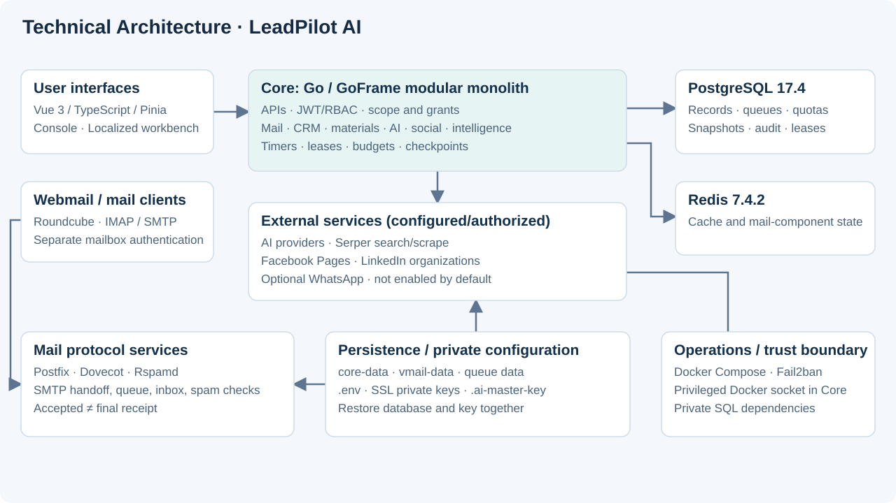
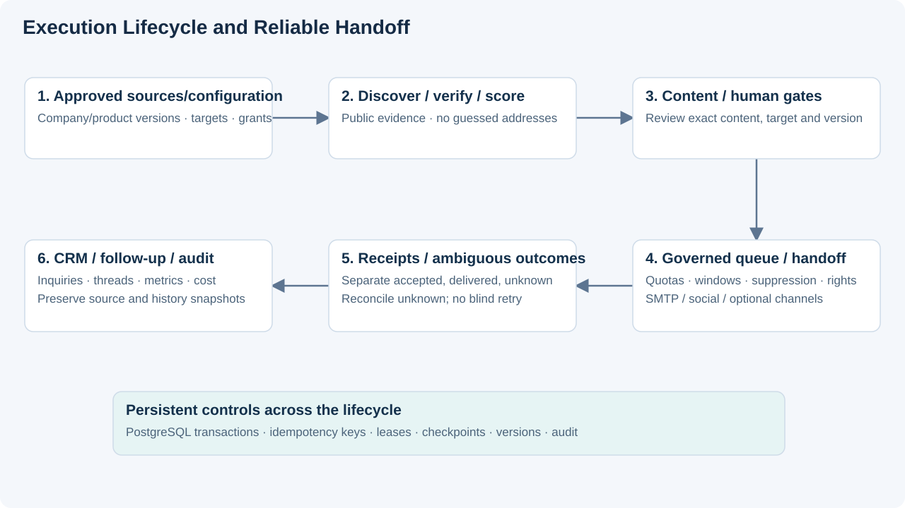

# Technical Architecture

**Product: LeadPilot AI | Document version: 1.0 | Analysis date: 2026-11-14**  
Source baseline: `cf57fb3`. This document describes repository code and Compose configuration, not a live production audit or performance certification. Screenshots use an existing local frontend build with fictional data; see the User Manual for provenance.

## 1. Product and architectural style

LeadPilot AI extends the BillionMail mail platform with B2B prospecting, content marketing and customer follow-up. The internal Go module remains `billionmail-core`; some container, directory and protocol identifiers retain BillionMail / MapleMail names while the user-facing brand is LeadPilot AI.

The backend is a **modular monolith**: HTTP APIs, domain services, timers and durable work queues run in one Go application. Mail protocol components run in separate containers. Growth Master's fourteen skills are registered logical capabilities, not fourteen independently deployed microservices. This repository does not require a separate message broker, managed agent cloud or general-purpose visual DAG engine.

Diagram source: [Mermaid architecture](../assets/diagrams/technical.mmd).

## 2. Technology inventory

| Layer | Evidence | Technology and responsibility |
|---|---|---|
| Management UI | `core/frontend/package.json` | Vue 3, TypeScript, Vue Router, Pinia; Naive UI components; Vue I18n |
| Frontend tooling | Scripts / pnpm lockfile | Rsbuild, Node.js 22, locked pnpm dependencies, Axios, streamed SSE responses, ECharts |
| Application | `core/go.mod` | Module Go 1.22, toolchain 1.23.2, GoFrame v2.9; controllers and domain services |
| Database | `docker-compose.yml` | PostgreSQL 17.4: records, authorization, execution state, leases, quota reservations, audit |
| Cache and support | Compose / Redis service | Redis 7.4.2: existing cache and mail-component state; durable tasks are not simply an in-memory Redis queue |
| Outbound mail | Postfix / relay services | SMTP handoff, queue, relay and sender identity; acceptance is not final receipt |
| Mail access | Dovecot / Roundcube | IMAP/POP3, mailbox authentication and storage; Webmail integrates through Core/PHP-FPM |
| Protection | Rspamd / Fail2ban | Spam processing, DKIM configuration and existing access protection |
| External integrations | `aimodels`, `growth`, `social` | AI providers, Serper search/scrape, Facebook Pages, LinkedIn organizations, optional WhatsApp |

Versions describe code declarations or default Compose values, not necessarily running production images. Provider capabilities, platform approval and API versions require operator verification.

## 3. Deployment and network boundaries

Default Compose defines seven application services: PostgreSQL, Redis, Rspamd, Dovecot, Postfix, Roundcube and Core. Core serves the console/APIs, selected public pages and reverse proxies; mail protocols remain separate.

- Use trusted HTTPS for production and restrict administrative entry and source addresses.
- PostgreSQL defaults to host binding `127.0.0.1:25432`; Redis to `127.0.0.1:26379`. Do not expose these ports publicly.
- Mail defaults include SMTP 25, Submission 587, SMTPS 465, IMAP 143/993 and POP3 110/995. Open only required services.
- `SafePath` is an additional entrance policy, not a substitute for JWT, account state, RBAC, TLS or a firewall.
- Core mounts the Docker socket and has additional container capabilities. A `:ro` host mount does **not** make the Docker API read-only; this remains a high-privilege trust boundary.
- The default Core image still references upstream naming. Use project-specific Dockerfiles/Compose overrides for customized code; pulling an upstream Core image does not deploy local changes.

## 4. Frontend application structure

`core/frontend/src` contains routes, pages, feature modules, stores, the API client and shared components.

1. `router/modules` defines navigation; stable identifiers, not localized titles, order menus.
2. `router/index.ts` checks local session state, loads the server Principal and evaluates page access.
3. `features/workspace/api.ts` provides department/role context and the permission catalog; buttons are operation-specific.
4. The workbench store manages multiple tabs, active-page state and request ownership so stale requests do not contaminate a different page.
5. `api/index.ts` adds Bearer authorization and `Accept-Language`, and handles business envelopes, downloads, cancellation and errors.
6. A common response envelope is `{code, success, msg, data}`. Hidden buttons are a usability measure; **server authorization remains mandatory**.

Language resources include Chinese, English, Japanese, German, Turkish and Vietnamese. This delivery provides Chinese and English guides, not certification of every translated business term.

## 5. Backend domains and API organization

| Domain | Responsibility | Location / entry |
|---|---|---|
| Bootstrap and routing | Initialization, model migration, timers, public pages, API registration | `core/internal/cmd/cmd.go` |
| Governance | Principal, role-bound data scope, shared policies, resource grants, legacy boundaries | `service/governance`, `controller/enterprise` |
| Email engine | Campaigns, schedules, automations, API mail, shared quotas, SMTP handoff | `service/batch_mail` |
| Materials / prospecting | Files, products, extraction, public evidence, contact verification, outreach, inquiries | `service/growth`; `/api/growth/action` |
| Intelligence | Industry packs, 14 skills, 6 workflows, approvals, budgets and audit | `growth/master_*.go`; growth action `master` |
| Social | OAuth, account grants, content versions, review, scheduling, delivery and metrics | `service/social`; `/api/social/action` |
| CRM | Customers, mailbox synchronization, follow-ups, AI drafts, manual replies | `service/crm`; `/api/crm/action` |
| AI registry | Unified model references, provider configuration, capabilities, encrypted secrets | `service/aimodels`, `service/aicredentials` |
| Mail operations | Domains/DNS, mailboxes, relays, mail statistics, SSL and containers | Related `domains`, `mail_boxes`, `mail_service` modules |

Several domains use action-style POST APIs. Do not infer REST endpoints from menu names. Integrations must use actual request contracts and authorization, rather than directly writing database tables or bypassing reviewed legacy boundaries.

## 6. Authorization and data protection

The business-access chain is: entrance policy → JWT validation → account/department/role status → operation permission → data scope → resource/mailbox grant → business-state checks.

Scopes include self, department, descendants, selected departments and all. The scope belongs to the role granting the operation; independently maximizing permissions and scopes across roles can widen access incorrectly. A sending permission is separate from a sender-mailbox grant.

`LegacyBoundary` restricts ordinary members from legacy administrative APIs whose queries may lack department predicates. Account and role changes affect sessions through token versions and live checks. Background senders re-check authorization rather than relying only on draft creation.

Files use private storage and authorized downloads. External content, filenames, archive paths, URLs and model output are untrusted. Model-generated email addresses are not source evidence, and generated text does not replace approval or authorize contractual commitments.

## 7. Data architecture

| Domain | Major entities | Relationships |
|---|---|---|
| Identity / governance | `account`, `role`, `account_role`, `bm_departments`, `bm_resource_grants`, `bm_send_policies`, `bm_security_audit` | Accounts, roles, departments, operation scope and grants |
| Contacts / email | `bm_contact_groups`, `bm_contacts`, `bm_tags`, `email_templates`, `email_tasks`, `bm_campaign_schedules`, `bm_automation_rules` | Department/owner, audience, template, task and subscription |
| Materials / growth | `bm_growth_companies/products/assets/versions`, `bm_growth_plans/runs/leads/messages/inquiries/jobs` | Approved company versions → execution → evidence → lead → outreach |
| Intelligence | `bm_gm_packs/workflows/runs/steps/evidence/prospects/contents/events/usage/audit` | Industry and skill snapshots, checkpoints, approvals, usage and audit |
| Social | `bm_social_accounts/plans/variants/deliveries/interactions/metrics/jobs` | Account authorization → reviewed variant → frozen delivery → receipt |
| CRM | `bm_crm_customers/messages/followups/mailbox_sync` | Customer, conversation, follow-up and synchronization cursor |
| Mail foundation | `domain`, `mailbox`, `recipient_info`, `bm_options`, others | Domains, mailboxes, recipient/subscription and system configuration |

Slash-separated names summarize entity families, not a complete DDL listing. Snapshots, business validation and logical archival also control lifecycle; foreign keys alone do not define deletion behavior.

Private growth storage defaults to `core/data/growth-files`, overridable with `MAPLEMAIL_GROWTH_DATA`. The credential master key `.ai-master-key` resides in the private storage directory. Restore the database together with this key, files, mail data and configuration; restoring only database rows does not restore secret decryption.

## 8. Durable execution and reliability

Timers start Growth, Social, email workers, imports, schedules and log aggregation. Database records hold state, checkpoints, quota reservations, unique keys and leases. Claiming commonly uses `FOR UPDATE SKIP LOCKED` with a unique lease marker.

Limits may apply simultaneously to system, department, mailbox, IP, provider and task. Zero removes only the extra limit at that layer; it does not override higher layers. Transactions and PostgreSQL advisory locks coordinate reservations. Failed attempts can remain conservatively charged.

Ambiguous HTTP/SMTP outcomes remain `unknown` and require reconciliation before retry. Pausing/canceling usually stops future work, not messages already in Postfix or posts already published externally. Application SMTP acceptance, mail-log delivery and recipient reading are distinct measurements.

## 9. AI registry and external boundaries

The registry centralizes provider name, HTTPS base URL, protocol, model ID, enabled state and declared capabilities: text/chat/vision/image/embedding. Canonical references are `ai::<provider>::<model>`.

- OpenAI Responses and OpenAI-compatible Chat Completions are different protocols; compatibility needs a real provider test.
- Declared vision/file support is not a guarantee. PDF input, image understanding and image generation are separate capabilities.
- Secrets are not returned in plaintext; interfaces show configured state. Changing a base URL can require renewed credentials to prevent forwarding to the wrong endpoint.
- Serper supports search/scraping; returned evidence does not establish complete internet coverage.
- Facebook/LinkedIn authorization, approval, publishing and metrics depend on platform products and granted permissions. Country/language selection is not advertising geo-targeting.
- WhatsApp is optional and requires the official account, templates, consent and webhook setup; it is not enabled merely because the interface exists.

## 10. Engineering limitations and risks

1. **Private SQL dependencies:** publication rules exclude migration/test SQL, while Go source embeds some of these files. A public clone alone cannot build the backend; matching scripts must be supplied privately.
2. **Runtime secrets:** never publish `.env`, `env_init`, private certificates, the AI master key or access tokens.
3. **Privileged Core:** control Docker socket access, container capabilities and mail-configuration operations tightly.
4. **Uncertain external outcomes:** unknown states, expired tokens, platform approvals, provider features and mail reputation require operator intervention.
5. **Validation scope:** full backend tests and frontend build timed out at baseline publication. Documentation captures are not a new full build or production acceptance test.
6. **HA and scaling:** default deployment is not multi-region HA. Before adding Core replicas, validate singleton timers, shared limits, leases, local Docker dependencies and duplicate-send protection; more replicas alone do not establish high availability.

See the Operations Guide for deployment, backup, rollback and troubleshooting.
