# Project User Manual

**LeadPilot AI | English edition | Version 1.0 | 2026-11-14**

## Scope and screenshot provenance

Procedures describe source baseline `cf57fb3`. Screenshots render **real application components** in headless Microsoft Edge using an existing local frontend build and **fictional demonstration data**. They do not connect to production or use actual accounts, customers, tokens or commercial records. Every image is labeled as a demonstration. Metrics, `example.com` / `example.org` addresses and companies are not business results.

These are not hand-drawn interface prototypes, but neither are they production evidence or backend integration tests. Build fingerprint, source baseline, capture inventory and browser-error results are recorded in `assets/screenshot-provenance.json`. Controls vary with version, language, permissions and configuration.

Operating rule: **save a draft, review it, then execute; reconcile uncertain external submissions before retrying.** This documentation task sent no customer mail, published no social content and made no paid AI/search calls.

## 1. First-use checklist

| Order | Action | Completion criterion |
|---|---|---|
| 1 | Verify HTTPS, administrative entrance, services and private backups | No shared default password; database and Redis not public |
| 2 | Configure departments → role scopes → members | Ordinary users cannot access unrelated departments or system APIs |
| 3 | Grant senders and configure shared policies | Explicit authorization, limits and a controlled test mailbox |
| 4 | Configure DNS, SSL and SMTP/relay | Final send/receive verified using owned test mailboxes |
| 5 | Configure AI providers, capabilities and budgets | Minimal real provider test; secrets never returned in plaintext |
| 6 | Create company/product/material records, review and publish | Supported facts; internal sensitive data excluded |
| 7 | Import a small contact sample and review status | Lawful source, confirmation, subscription and filtering understood |
| 8 | Create a draft or plan with automatic sending disabled | Evidence, content, targets and budget reviewed |
| 9 | Approve and test only with controlled targets | Receipt, unsubscribe, replies and metrics verified |

The public repository intentionally excludes SQL, runtime secrets, private keys and installation packages. Prepare matching private SQL dependencies according to the Operations Guide; cloning GitHub is not application installation.

## 2. Login, language and workbench

1. Obtain the **actual administrative entry** from your administrator. A deployment may require SafePath; do not guess or publish a private entrance.
2. Use trusted HTTPS, select language and sign in with your personal account.
3. Enter the Department Workspace and confirm account/department context. The top bar supports multiple workbench tabs.
4. Open authorized functions. Missing controls should prompt a rights check, not URL/API bypass attempts.
5. Sign out on shared computers. Do not capture passwords, verification codes or API tokens in screenshots.

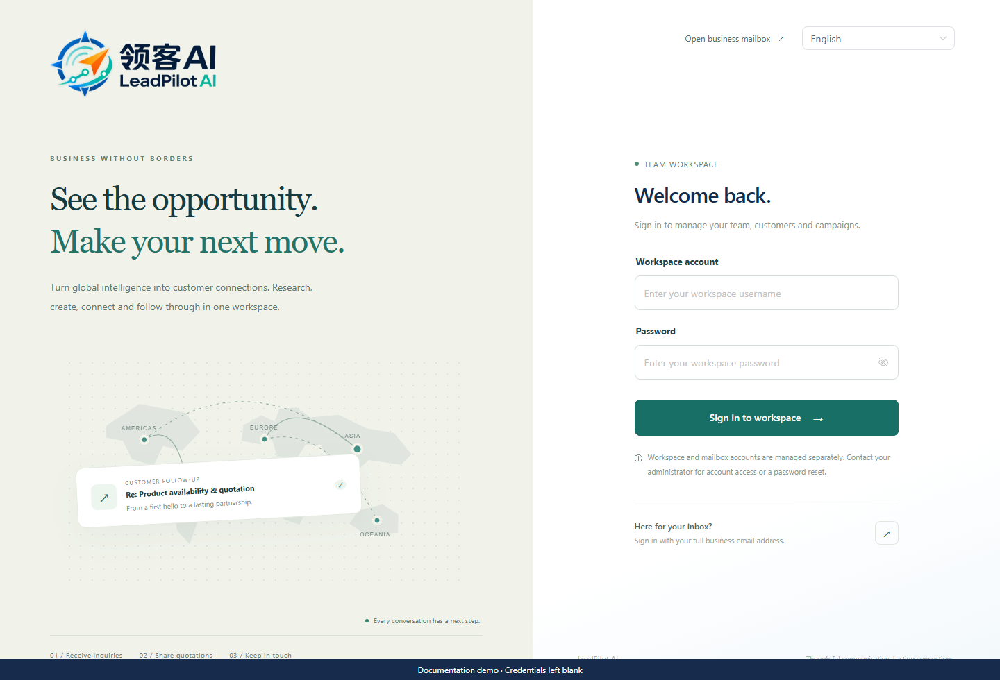

Tab state is not proof unsaved edits were persisted. Browser reload, page refresh and executing a task are different operations.

## 3. Organization and access (administrators)

### 3.1 Departments

Open **Department Workspace → Department**. Add the name, parent and enabled state, then save. Establish the tree before assigning members so data ownership is clear.

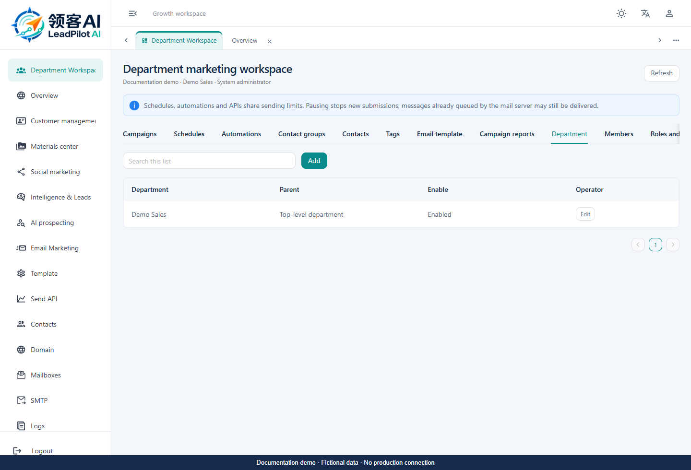

### 3.2 Roles and data scope

Open the role-management tab and configure a role name, operation permissions and data scope. Start with the smallest scope; expand only where justified.

- Self: permitted records owned by that user.
- Department / descendants: restricted by department membership/tree.
- Selected departments: explicit selection.
- All: does not automatically make the user a system administrator or grant every mailbox/Page.

Create, edit, delete, import, export, publish and settings permissions are separate. Read permission alone does not authorize publishing.

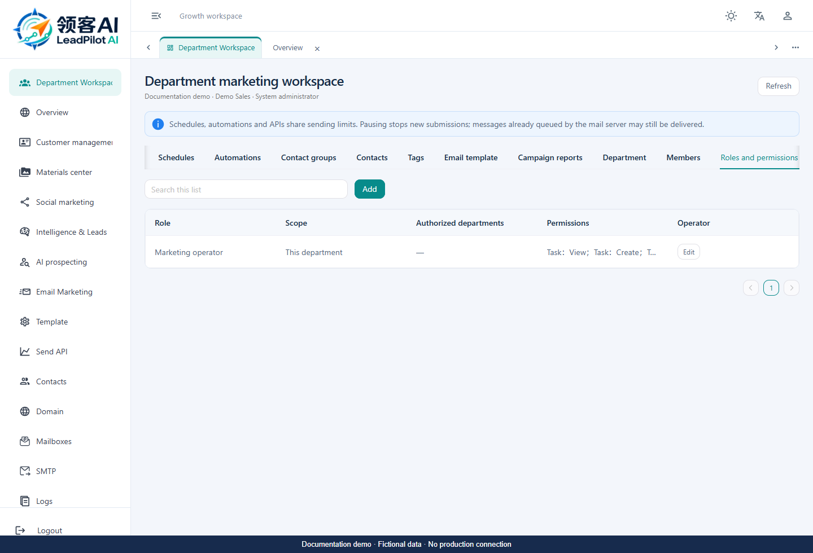

### 3.3 Members, sender grants and policies

1. Assign a new member to a department and roles; set a private initial password.
2. Grant the department access to appropriate sender mailboxes. Both operation permission and mailbox authorization must apply.
3. Configure system/department/mailbox/IP/provider limits: minute/hour/rolling-day volume, spacing, concurrency, timezone/window and recipient cooldown.
4. Verify list, export, private download and sending boundaries with an ordinary account. Test revocation against background work too.

Disabling a member/department does not remove historical records. Moving members does not migrate all historical ownership; existing tasks may stop because ownership no longer matches.

## 4. Domains, mailboxes and mail services

### 4.1 Domains

Use **Domain** to maintain the mail domain, hostname, mailbox limits and related settings. Follow the system's actual records for MX, A, SPF, DKIM and DMARC. Operations staff must also validate PTR/outbound IP and provider SMTP restrictions.

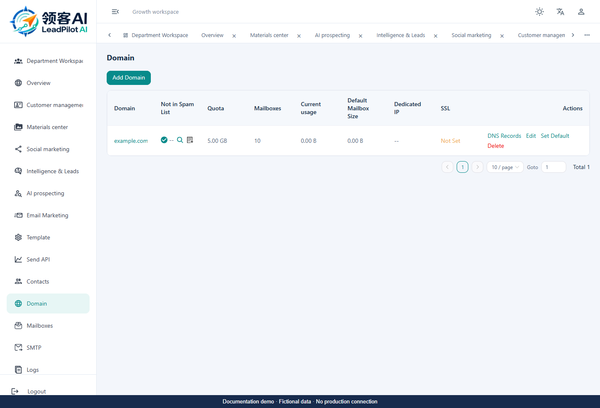

Use a single appropriate SPF record, verify signatures and DMARC alignment, and avoid increasing volume before deliverability is validated. TLS private keys remain private and must not be committed.

### 4.2 Mailboxes

Use **Mailboxes**, choose the domain and create individual or batch mailboxes with quota, active status and a password.

- The interface no longer pre-fills a fixed password; enter one satisfying its rules for individual/batch creation.
- Empty-password backend requests only fall back when private `DEFAULT_NEW_MAILBOX_PASSWORD` is configured correctly. Otherwise creation is rejected.
- Leaving password blank during an existing mailbox update preserves its current credential; changing a name should not reset the password.
- A mailbox account is not automatically a console account. Webmail uses mailbox authentication.

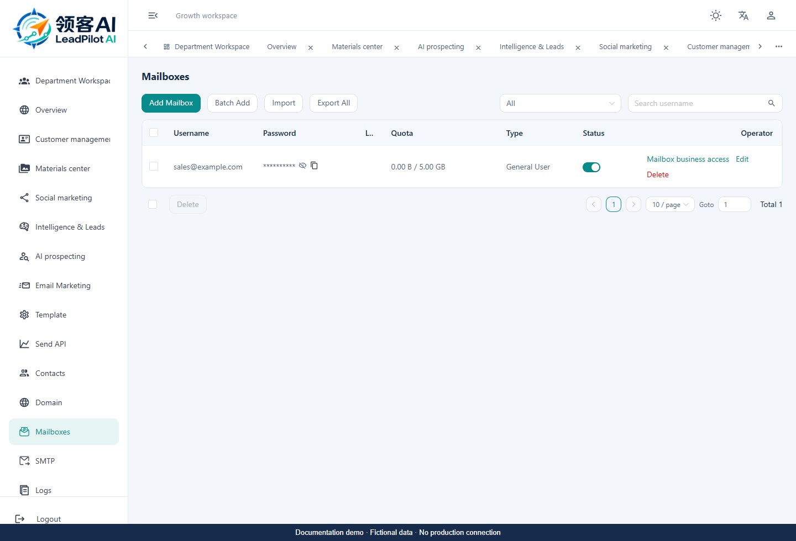

Test with owned mailboxes: SMTP handoff, final receipt, IMAP/Webmail access and replies. An accepted submission alone does not establish inbox receipt.

## 5. AI model service and budgets

Open **Settings → AI model service**. Social/prospecting settings also expose related entry points; runtime choices come from the shared registry.

1. Add a provider, choose the protocol actually supported (Responses or Chat Completions) and the correct HTTPS base URL.
2. Enter the credential only in the private administration interface, never in chat, documentation, screenshots or GitHub.
3. Add/discover model IDs and verify enabled status, text/chat/vision/image/embedding capabilities and output limit.
4. Set capability-specific defaults and daily call/Token budgets, then save.
5. Run a minimal controlled test through the actual test entry or task to confirm protocol/model/quota. A successful save is not a successful provider call.
6. When changing endpoints, renew credentials as required so saved credentials are not sent to the wrong provider.

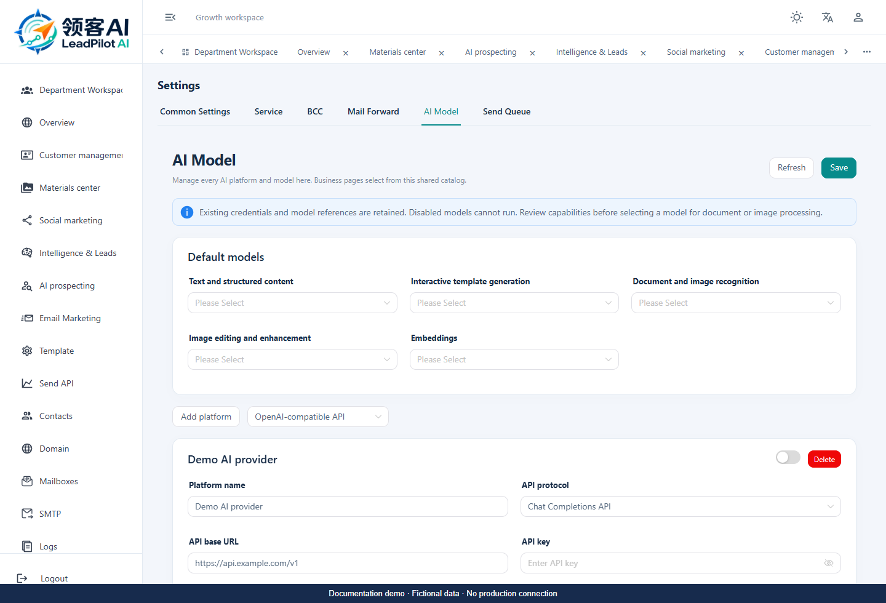

Vision, PDF input, image generation and web search are distinct features. Do not assume a chat-only model accepts PDFs. Provider claims, registry declarations and real behavior all need verification.

## 6. Company, products and materials

Open **Materials center** and select a company or create a draft. Record brand, domains and supported product/service facts.

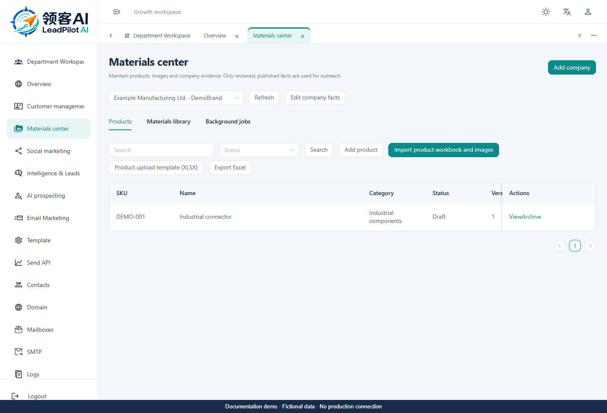

### 6.1 Company facts and approval

Review names, business scope, contacts, promises and evidence before publishing. Only approved external facts should enter automated marketing. Shared departments read approved records within grants; internal files do not become public automatically.

### 6.2 Product spreadsheets and images

1. Download the current product/industry template and fill its fields.
2. Upload XLSX and inspect all worksheets, original rows, text SKUs/leading zeros and mappings.
3. Resolve missing IDs, conflicting values and ambiguous image matches through review.
4. Re-imports should not overwrite protected human edits; inspect actual results.
5. Associate images, verify primary/other image roles and publish reviewed products.

Archives must not contain path traversal, private keys, database backups or sensitive internal documents. Company uploads, product import and social task files have different format/size limits; use the current module's rules rather than one assumed global limit.

### 6.3 AI extraction and versions

For supported PDFs, Office documents or images, explicitly permit recognition and select an appropriate model. Review extracted facts, citations and uncertainties before merging into a draft. Cost, bank, credential and internal procurement fields must not become external copy. Published versions remain traceable; material changes can invalidate unsent outreach snapshots.

## 7. Contacts, groups and import

Business members can use workspace contact groups, contacts and tags. Administrators may also see separate Contacts pages.

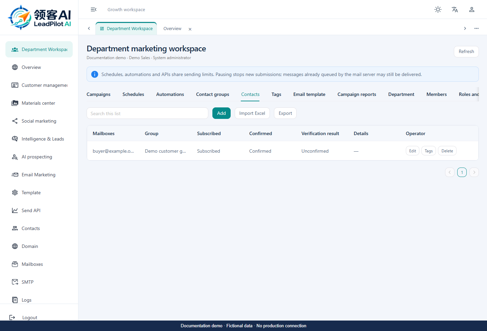

1. Create a clear department-owned group with a description.
2. Use the import formats accepted by the current page. Preview fields/addresses, set exclusions, and review duplicates/uncertain results.
3. Distinguish address verification, active status, subscription and confirmation. Public discovery does not establish permission to market.
4. **Importing confirmed contacts can trigger enabled subscription automations.** Disable/review related rules first if uncertain.
5. Apply tags and select audience logic such as AND/OR/NOT. Check final audience preview, not just the group's total count.
6. Export requires independent permission. Keep customer exports in approved private storage, not the public repository.

## 8. Templates, campaign drafts and email delivery

### 8.1 Templates

Create a template in Template or the workspace template tab. Edit HTML or use AI assistance. Preview layout, links, brand, formatting and unsubscribe. Use merge-variable syntax actually supported by the page; this guide does not invent variable names.

### 8.2 Create a task

Open **Department Workspace → Campaigns** and create a new task:

1. Name it and choose subject, contact groups, tag logic, template and sender pool.
2. Verify display name, reply/CC settings, open/click tracking and unsubscribe.
3. Configure interval, concurrency, rolling limits, batching/rest, timezone/window and cooldown. Zero does not bypass higher-level rules.
4. Preview audience/content and save a draft. A permitted operator reviews and publishes it.
5. Begin with controlled internal recipients and verify final receipt, not only submitted counts.

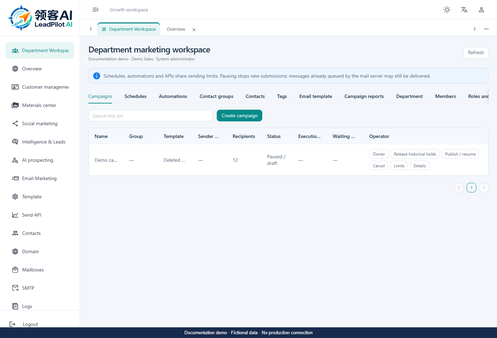

### 8.3 Monitoring and uncertain outcomes

- Pause/cancel stops subsequent handoff; mail already queued in the server can still leave.
- Investigate quota, time-window, permission or cooldown reasons before increasing concurrency.
- `unknown` means submission cannot be confirmed. Check queue/logs before sending again.
- Opens/clicks are observations influenced by privacy proxies/scanners, not reliable contractual receipt evidence.

### 8.4 Schedules and subscription automation

Once/daily/weekly/monthly schedules run in the configured timezone and create separate tasks. Review month-end and DST behavior. Recovery does not replay every missed historical date in a burst.

Subscription automations are ordered steps: wait, always send, previous message opened/clicked/not opened. Edits affect new enrollment while existing runs retain snapshots. Validate using test contacts before enabling real rules.

## 9. AI prospecting

Open **AI prospecting** after reviewing and publishing company/product materials.

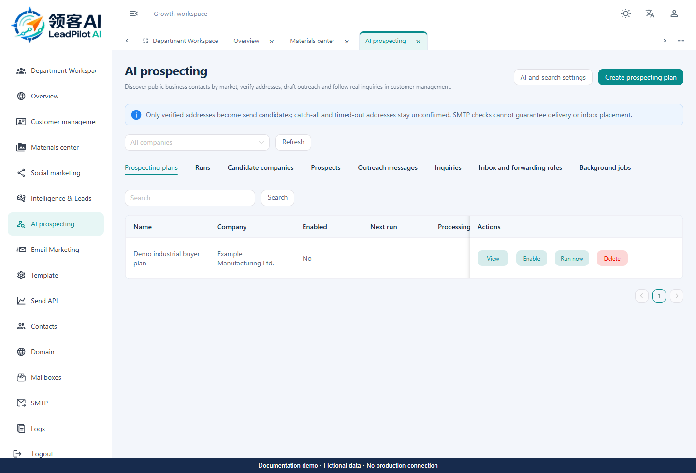

1. Create a plan; choose company and offerings, country, language, timezone and buyer requirements.
2. Set queries/sites, daily lead/send volume, address filters, sender pool, delivery window and cooldown.
3. Disable auto-send for the first small discovery run.
4. Inspect run/candidate records: URLs, market fit, public contact evidence and verification results.
5. Invalid addresses must not enter outreach. Review uncertain/catch-all results; do not treat guessed addresses as valid.
6. Check generated text, source versions, recipient language, supported claims and unsubscribe, then approve delivery within rights.
7. Review inquiries and inbox rules. Suspected human replies can pause further outreach; genuine inquiries link to CRM and configured forwarding.
8. Regenerate only where the interface allows it for unsent, non-unknown content. Do not use regeneration to evade duplicate-send protection.

Plan changes can pause it by default. Revocation, source changes, unsubscribe, replies and cooldown affect later handoffs. A completed discovery run does not mean mail was sent or a sale occurred.

## 10. Intelligence and Growth Master

Open **Intelligence & Leads** and choose a company. It is a controlled industry-pack/14-skill/6-workflow system, not an arbitrary node editor.

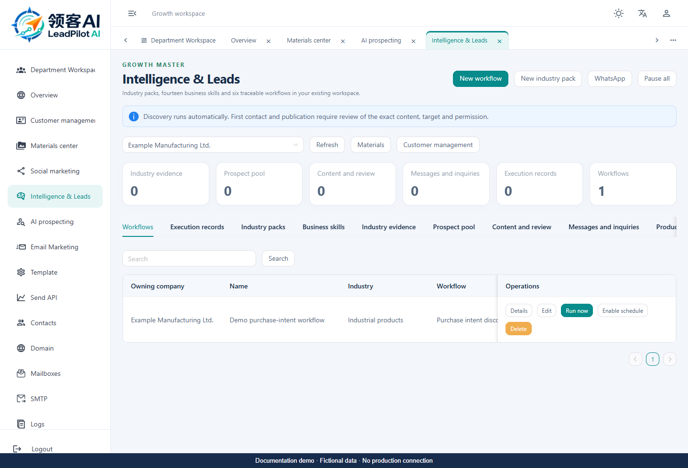

### 10.1 Industry pack

Create or clone a pack. Configure product/service type, terms, buyer/intent/exclusion words, sources, schema, scoring, minimum score/confidence and forbidden claims. Clone system templates before customizing. Confirm AI-expanded terms explicitly.

### 10.2 Skills

Choose skill-specific models and item/output/timeout/retry limits. Verify search, verification, materials and channel capabilities before granting broad budgets.

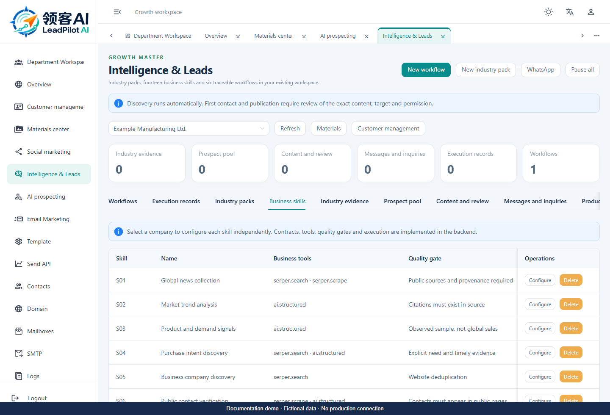

### 10.3 Workflow execution

1. Choose WF01 market observation, WF02 purchase intent, WF03 discovery, WF04 content/channels, WF05 inbound handling or WF06 growth analysis.
2. Configure markets, materials, senders/Pages, thresholds, cadence and call/Token/search/scrape/send budgets.
3. Save and run a small manual test. Inspect runs, checkpoints, evidence, candidate scores and wait/failure reasons.
4. Review **exact content, target and frozen source version**. The model cannot approve its own first contact/publication.
5. Any controlled auto-reply rules require explicit reviewed rules and allowed facts. Sensitive commercial commitments remain human decisions. Normal CRM AI drafts require explicit sending.
6. Resolve configuration, exhausted budget, approval or external-wait causes before resuming.
7. Administrator emergency pause blocks future work; it does not recall content already sent externally.

## 11. Social accounts, content and scheduling

Open **Social marketing**. Prepare approved company facts and official platform authorization before moving from draft to review and schedule.

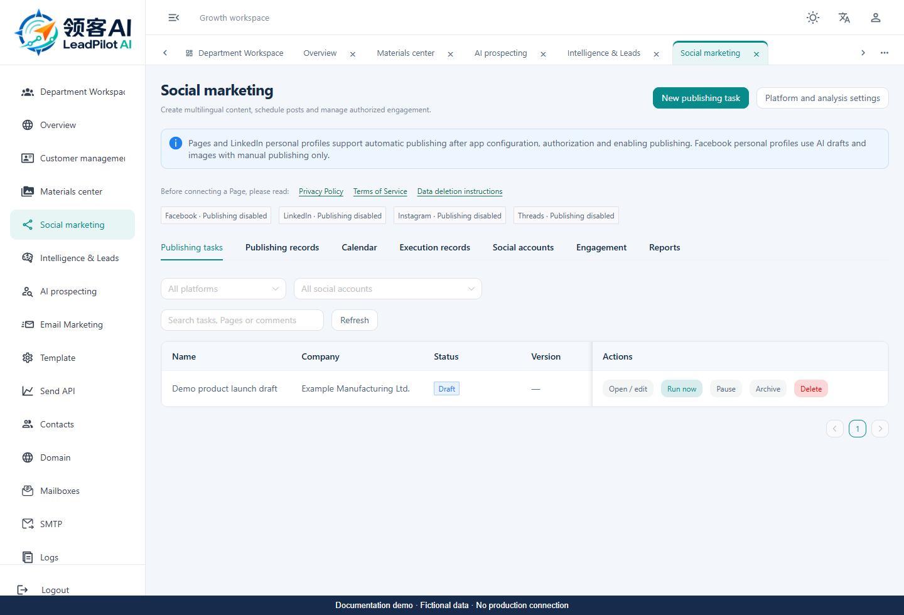

### 11.1 Platform/account setup

1. Administrators configure the official application, callback, approved permissions and publishing switch.
2. Use official OAuth and explicitly select Pages/accounts. Do not paste tokens into public documents.
3. Verify department, management capabilities, expiration and delivery mode.
4. Authorization and live publishing are separate switches; a connection alone does not authorize automation.

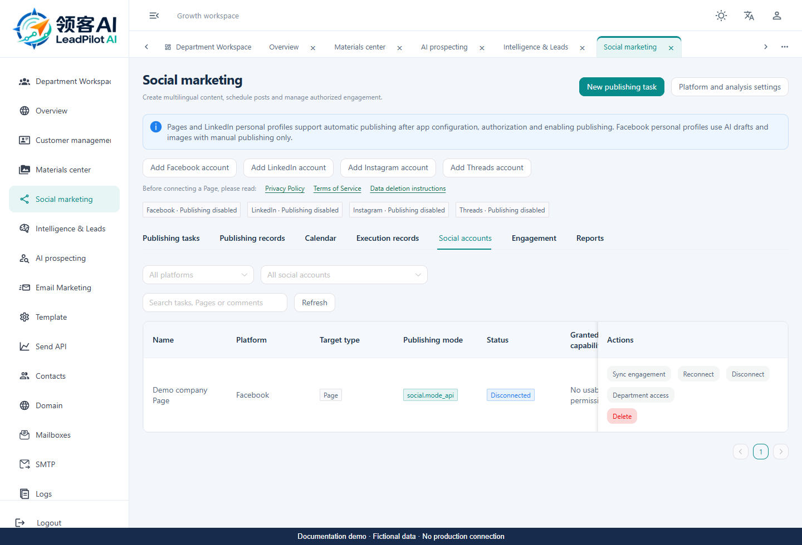

### 11.2 Variants and review

Create a task with company, platform, country, language, account and local time. Select/upload approved sources, generate or write variants, and review links, images, paragraphs, translation and factual claims. Content edits require renewed review. A task can match multiple accounts across market variants.

Country/language selection is content localization, not advertising geo-targeting. Task-only files and published materials have different lifecycles; archival into Materials center is explicit.

### 11.3 Submission and reconciliation

Schedule approved content and verify timezone/DST. API mode hands off to authorized platform APIs. Manual mode requires the operator to actually publish on the platform and then confirm in the interface; that confirmation is not automatic-publication proof.

For timeout/unknown results, verify actual post ID and ownership before retry. Deleting task/record does not remove an external post. Reconnect expired/revoked authorization instead of fabricating a successful status.

### 11.4 Interactions and measurement

Local refresh reads stored state; platform synchronization fetches official measurements. Review update time, coverage and `—`; missing is not zero. Respect platform rules for member data, comments, AI use and retention. This guide provides no unrestricted auto-comment, advertising or video-publishing procedure.

## 12. CRM, inquiries and replies

Open **Customer management** to search authorized customers, stages and follow-up dates.

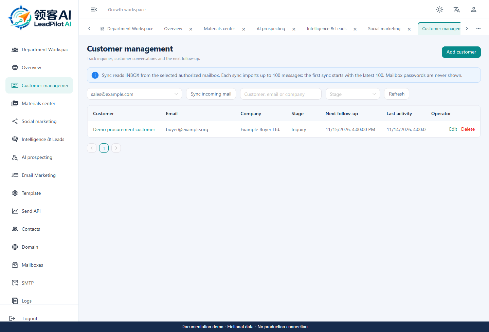

1. Select an authorized inbox and synchronize INBOX. Initial scope/cursors follow the implementation and do not imply complete historical import.
2. Separate inquiries, automatic replies, unsubscribe and uncertain messages; confirm ambiguous classification manually.
3. Open the correct customer/thread. Maintain company, stage (new/inquiry/quoted/negotiating/won/lost) and next follow-up.
4. Generate an AI draft with the correct company facts, fill missing facts and edit it.
5. **Check recipient, sender, subject, attachments and commitments, then explicitly send.** Draft generation is not delivery.
6. Reconcile unknown forward/reply records with mail logs and conversation history before repeating.

## 13. Overview, reports and daily review

Choose domain/period in Overview and correlate task statistics, mail-server logs, bounce, tracking coverage and queue state.

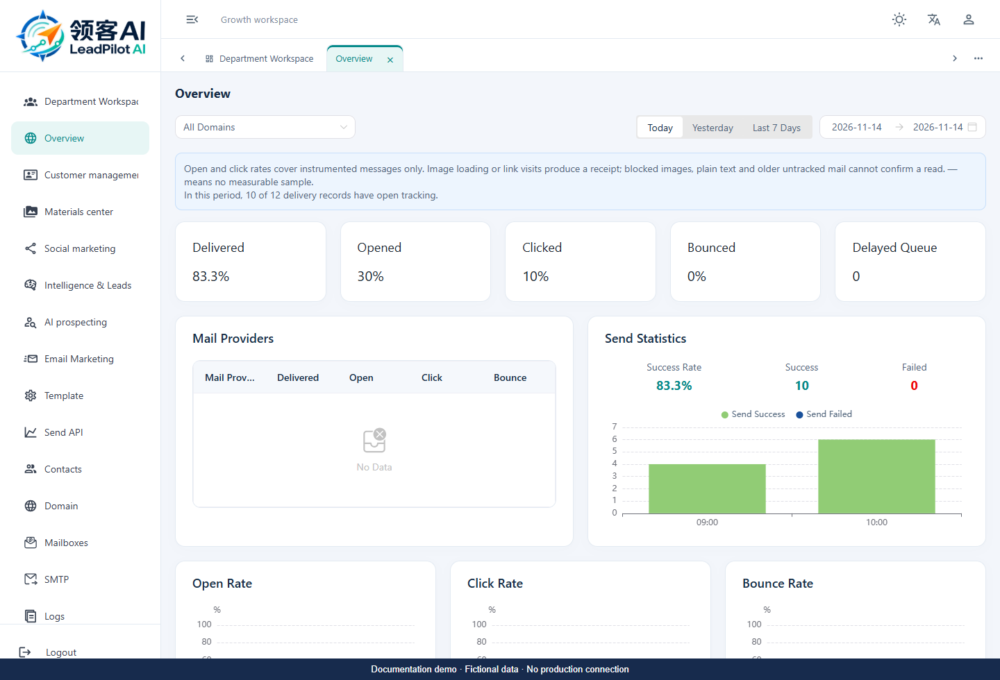

Daily review should include pending/unknown work, approvals, exhausted budgets, expired grants, bounce anomalies, unsubscribe, customer follow-ups, disk capacity and backups. Exports require permissions; customer details must not be published to GitHub.

## 14. Quick troubleshooting

| Symptom | Check first | Avoid |
|---|---|---|
| Missing menu/button | Operation rights, scope, resource grant, account status | Guessing legacy APIs or bypassing UI |
| New mailbox rejected | Password rules; private fallback for empty API input | Restoring a hardcoded shared password |
| Model unavailable | Enabled provider, key, protocol, capability, budget | Treating save as a working provider test |
| Lead not sent | Source/verification freshness, subscription, suppression, cooldown, plan | Marking uncertain addresses verified by force |
| Long pending state | Shared limits, windows, grants, logs and queue | Raising concurrency or duplicating tasks blindly |
| Social submission blocked | Approved app, mode, granted rights, reviewed version, token | Inventing a post ID |
| Unknown state | External receipt and worker/mail logs | Retrying before reconciliation |
| Secrets fail after restore | Matching database and `.ai-master-key` | Restoring only DB or overwriting the key |
| Public clone cannot compile | Private SQL, dependencies, frontend output/configuration | Force-adding secrets or private scripts |

## 15. Definition of completion

Report the level of success: saved, verified, queued, externally accepted, finally delivered, or business-confirmed. Production acceptance still requires isolated rights tests, controlled delivery, unsubscribe, replies, official platform authorization and unknown recovery. Screenshots and this manual do not substitute for those checks.
