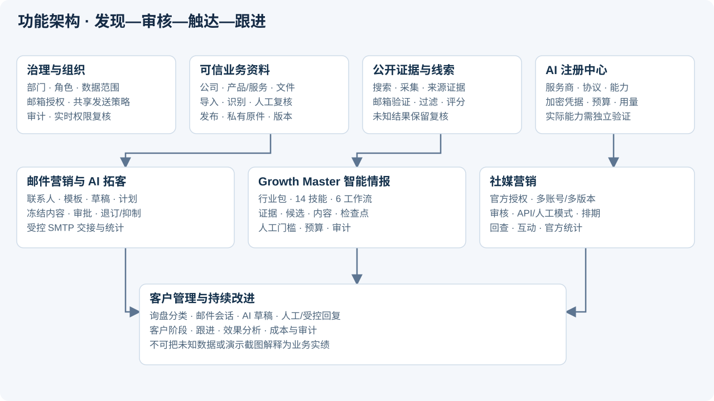

# 功能架构说明

**领客AI · LeadPilot AI｜版本 1.0｜2026-11-14｜源码基线 `cf57fb3`**

## 1. 业务闭环

系统将“准备可信业务资料 → 获取公开证据 → 发现候选客户 → 验证联系人 → 生成内容 → 审批与合规投递 → 处理回信 → CRM 跟进与效果分析”连接在同一管理台内。它不是承诺自动成交或自动获得合法营销许可的系统。

图源：[Mermaid 功能架构](../assets/diagrams/functional.mmd)。

## 2. 功能域与导航

| 功能域 | 页面/入口 | 输入与核心操作 | 输出及边界 |
|---|---|---|---|
| 登录与工作区 | `/login`、`/workspace` | 账号、部门、角色、工作区标签、权限 | 服务端授权范围内的功能；管理员和普通成员界面可能不同 |
| 数据概览 | `/overview` | 域名、时间范围、邮件日志/统计 | 投递、打开、点击、退信、队列等；覆盖范围与未知值需分开解释 |
| 部门与权限 | 工作台的部门、成员、角色、邮箱授权、发送策略 | 部门树、角色范围、操作权限、邮箱授权 | 数据隔离、共享限制、审计；邮箱授权不等于角色权限 |
| 联系人与标签 | `/contacts` 或工作台对应标签 | 分组、邮箱、导入文件、筛选关键词、确认/订阅状态、标签 | 可用受众、导入进度和复核结果；发现地址不代表营销许可 |
| 模板与邮件营销 | `/template`、`/market` 或工作台 | HTML/AI 模板、受众、发件箱池、主题、策略、审核 | 独立任务、冻结内容、队列和统计；暂停不撤回已提交邮件 |
| 计划与自动化 | 工作台计划/自动化、`/automation` | 一次/每日/每周/每月、时区、订阅确认与顺序条件 | 每次独立运行；自动化是受控顺序规则，不是任意节点画布 |
| 发信 API | `/send` | API 权限、业务受众与模板、合法凭证 | 接入统一发送控制；不能绕过部门范围和全局限额 |
| 资料中心 | `/materials` | 公司/品牌事实、产品、文件、导入映射、识别和发布 | 已发布对外资料、版本快照、私有原文件、待复核行 |
| AI 智能拓客 | `/outreach` | 公司/已发布产品、市场、搜索要求、验证、发送策略 | 候选、线索、开发信、询盘与后台任务；只使用来源中真实出现的邮箱 |
| 智能情报获客 | `/intelligence` | 行业包、技能、六类工作流、质量阈值、预算 | 证据、候选池、内容审批、执行检查点、成本与审计 |
| 社媒营销 | `/social` | 官方账号授权、平台/市场/语言、多版本内容、人工审核和排期 | 发布记录、人工发布提醒、日历、互动及统计；受平台权限约束 |
| CRM 客户管理 | `/crm` | 客户、邮箱同步、会话、阶段、跟进记录、AI 草稿 | 询盘、回复与跟进；AI 草稿不自动等于已发送回复 |
| 模型注册中心 | `/settings/ai-model`，相关模块中的 AI 设置入口 | 服务商、协议、模型能力、密钥、预算 | 统一模型选项与加密凭据；保存配置不证明联网调用成功 |
| 邮件基础与运维 | `/domain`、`/mailbox`、`/smtp`、`/logs`、`/settings` | 域名/DNS、邮箱、SSL、中继、队列、容器和系统配置 | 收发基础设施与问题诊断；高权限操作需管理员审核 |

导航地址描述源码中的路由，不包含部署专属 SafePath，也不是公开生产入口。部分业务菜单对管理员保留旧页面，对普通成员展示部门化工作台；操作手册以工作台的统一业务流程为主。

## 3. 角色职责与审批分工

| 角色 | 推荐职责 | 必须额外校验 |
|---|---|---|
| 系统管理员 | 部门、账号、角色、邮箱授权、AI/平台配置、基础运维 | 最小授权、主密钥与备份、全局发送限制 |
| 资料维护人员 | 公司和产品事实、导入、文件识别与复核 | 人工修改保护、敏感字段、公开/内部区分 |
| 内容审核人员 | 资料发布、邮件/社媒内容审核、事实与来源核查 | 版本、国家语言、商标/合规、退订和对外承诺 |
| 营销操作员 | 受众、草稿、计划、内容版本与执行监控 | 邮箱/主页授权、发送窗口、预算、客户冷却 |
| 销售/客服 | CRM、询盘、跟进、回复草稿与人工发送 | 正确客户/邮箱、敏感信息、承诺与重复回复 |
| 审计/只读人员 | 统计、执行结果、来源证据及操作审计 | 只读权限、部门范围、导出权限 |

推荐分工是配置原则，不是系统内固定角色名称。实际能力由操作权限、角色数据范围、资源授权和实时状态共同决定。

## 4. 资料到邮件的业务链

1. 公司资料保存内部草稿；复核事实后单独发布。
2. 产品导入保留工作表、原行号、文本 SKU 和待复核冲突；人工确认后发布产品/素材。
3. 拓客计划选择已发布资料、目标市场、搜索与邮箱过滤条件。
4. 搜索/抓取保存公开来源；模型不负责凭空推测邮箱。
5. 服务端执行 DNS/MX、SMTP/Catch-all 等验证；无效地址排除，无法确认地址保留复核。
6. 满足验证、权限、订阅/抑制与冷却条件后生成个性化开发信，冻结来源版本。
7. 操作员审核，或在已明确启用的拓客自动发送策略下进入现有邮件引擎。
8. SMTP 前再次检查权限、资料版本、退订、计划状态、回信和共享限额。
9. 真实/待确认询盘进入处理流程，关联 CRM 与跟进；不明确结果不盲目重发。

“验证通过”是当次探测结果，不是永久可达保证；“平台/SMTP 已接受”不是客户已收到或已阅读。

## 5. Growth Master：技能与工作流

Growth Master 用单一逻辑规划器协调固定注册的技能，并保存执行快照。每个技能可配置启用状态、模型、超时、重试、条数和输出预算。

| 编号 | 技能 | 关键质量门槛 |
|---|---|---|
| S01 | 全球新闻监测 | 公开来源与采集覆盖 |
| S02 | 市场趋势分析 | 引用必须对应实际证据，保留不确定性 |
| S03 | 产品热点识别 | 观察信号不冒充销售统计 |
| S04 | 采购意向识别 | 日期与证据来源 |
| S05 | B2B 公司发现 | 公开网站与去重 |
| S06 | 联系人情报 | 联系方式必须出现在来源中 |
| S07 | 数据清洗 | 有效、无效、无法确认、过滤分开处理 |
| S08 | 线索评分 | 缺失事实计零，记录规则版本和评分分项 |
| S09 | 产品/服务匹配 | 只引用批准的业务对象及可证实条件 |
| S10 | AI 内容生成 | 首次触达或发布前核查具体内容和目标 |
| S11 | 营销编排 | 审批、权限、退订/抑制、预算和授权共同满足 |
| S12 | 回信理解 | 分类和草稿；禁止未经授权的合同承诺 |
| S13 | 增长分析 | 缺失指标保留未知，不伪造数据 |
| S14 | 数据同步与审计 | 部门范围、去重、CRM 关联与审计 |

| 工作流 | 技能序列 | 业务目的 |
|---|---|---|
| WF01 | S01 → S02 → S03 → S14 | 行业/市场观察与热点整理 |
| WF02 | S04 → S05 → S06 → S07 → S08 → S09 → S14 | 采购意向驱动的候选发现与筛选 |
| WF03 | S05 → S06 → S07 → S08 → S09 → S14 | 常规公开 B2B 客户发现 |
| WF04 | S10 → S11 → S14 | 多语言内容、审核与渠道交接 |
| WF05 | S12 → S08 → S09 → S14 | 来信理解、机会评分和跟进 |
| WF06 | S13 → S02 → S14 | 日常效果、成本及改进分析 |

行业包定义产品/服务类型、术语、买家类型、意向词、排除词、字段、评分权重、置信度和禁止声明。AI 扩词需要勾选确认，不能当作真实采购证据。

工作流包含 `waiting_approval`、`waiting_external`、`configuration_required`、`budget_exhausted` 等受控等待场景；修复原因后按操作入口恢复，不把等待统一解释为失败。已有生产计划不会因为创建行业包自动加入新工作流。

## 6. 社媒营销链

公司/任务材料 → 内容版本 → 平台/账号/市场匹配 → 人工审核 → 排期 → 账号授权及预算复核 → 外部提交 → 结果回查 → 互动与官方统计。

- 可选择多个授权账号，保留账号与市场版本匹配；授权完成不自动启用真实发布。
- Facebook Page、LinkedIn 组织主页 API 发布与个人账号人工发布模式要区分。人工确认不是系统自动发布证据。
- 修改内容后需重新审核；排期冻结正文、图片、版本和策略。
- 结果不明确进入 `unknown`；删除任务不删除平台已有帖子。
- 页面刷新本地状态与向平台同步统计是不同操作；现有实现包含四小时自动同步和手动同步。
- 未提供的指标为 `—`，不能当成零；帖子触达人数之和不代表独立用户数。
- 视频、直播、广告投放、任意平台自动评论回复不是本手册承诺的能力。第三方数据使用须遵守启用时的平台政策。

## 7. 联系人与自动化状态边界

联系人确认、订阅、启用、验证和营销许可是不同属性。导入为已确认联系人可能触发启用的订阅自动化，导入前必须核查。

自动化支持等待、始终发送、上一封已打开、已点击或未打开等顺序条件，且通常只纳入规则建立后新确认联系人。跟踪信号可能受邮件代理或安全扫描影响。

计划按时区运行并防止重叠；停机后的补运行不是集中补发所有历史日期。权限撤销、负责人部门变化、邮箱授权撤销和退订会影响后续任务。

## 8. 功能验收矩阵

| 验收域 | 至少应验证 | 本次文档交付是否代表已完成 |
|---|---|---|
| UI | 路由、组件、多语言、可见入口 | 截图使用真实前端组件和虚构数据；不代表后端联调 |
| 权限 | 部门隔离、角色范围、文件下载、后台再校验 | 仅说明实现；生产仍需实际权限测试 |
| 邮件 | 内部测试邮箱、最终投递、退订、退信、unknown | 未向真实客户发送 |
| AI/搜索 | 正确协议、密钥、预算、引用和失败处理 | 未在本次文档任务中调用付费服务 |
| 社媒 | 官方授权、审批、发布/人工模式、回查与统计 | 未真实授权或发帖 |
| 运维 | 私有 SQL、主密钥、完整备份、恢复演练 | 文档提供流程，未修改生产服务 |

详细操作步骤、截图和常见错误见《操作手册》与《运维指南》。
