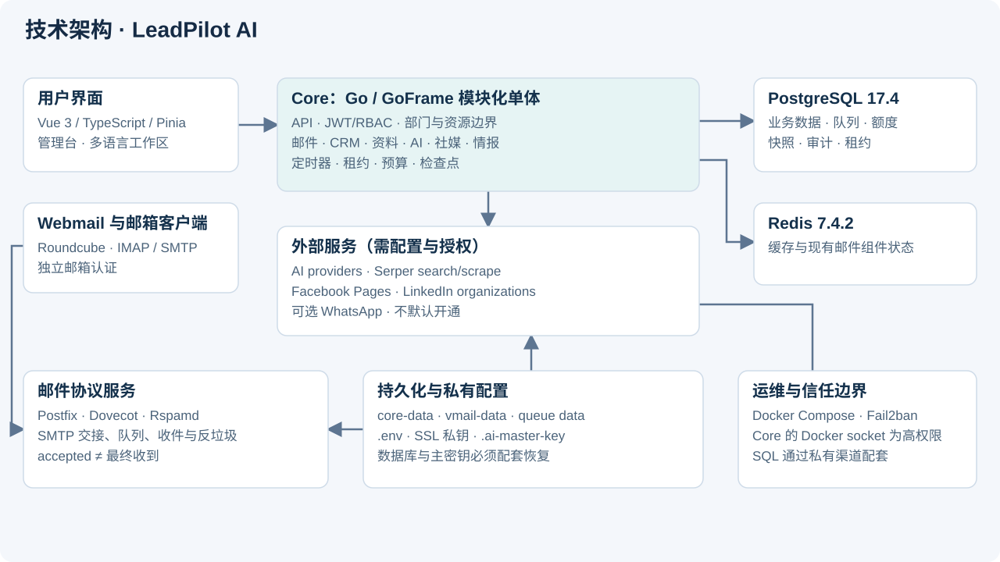
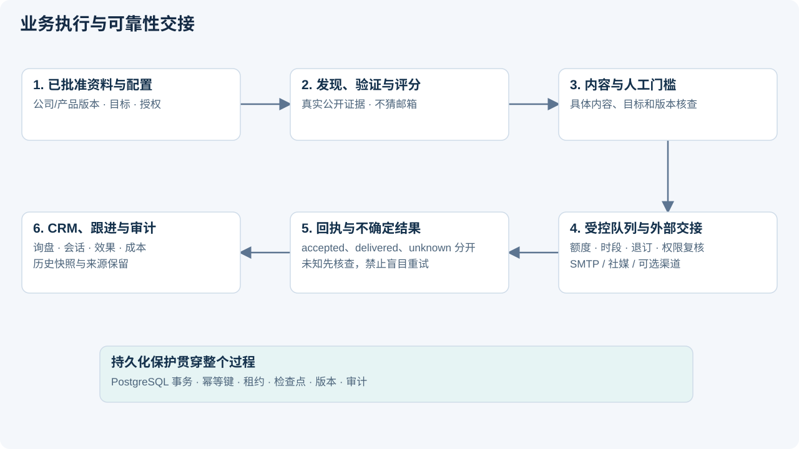

# 技术架构说明

**系统：领客AI · LeadPilot AI｜文档版本：1.0｜分析日期：2026-11-14**  
分析基线：`cf57fb3`。本说明基于仓库源码和 Compose 配置，不等同于生产环境巡检或性能验收。界面截图使用本地已有前端构建与虚构数据，详见《操作手册》的截图说明。

## 1. 系统定位与架构风格

系统是在 BillionMail 邮件服务基础上扩展的 B2B 获客、内容营销和客户跟进平台。内部 Go 模块名仍为 `billionmail-core`，部分容器、目录与协议名称保留 BillionMail / MapleMail，外部品牌为 LeadPilot AI。

后端是**模块化单体**：HTTP API、业务服务、定时器、持久化工作队列在同一 Go 应用内运行；邮件协议组件以独立容器运行。Growth Master 的 14 项业务技能是应用内注册的逻辑能力，不是 14 个独立微服务。本仓库没有独立消息中间件、独立 Agent 云服务或通用可视化 DAG 引擎的部署依赖。

图源：[Mermaid 技术架构](../assets/diagrams/technical.mmd)。

## 2. 技术栈与职责

| 层级 | 源码/配置依据 | 技术与职责 |
|---|---|---|
| 管理界面 | `core/frontend/package.json` | Vue 3、TypeScript、Vue Router、Pinia；Naive UI 组件；Vue I18n 多语言 |
| 前端构建 | 前端 scripts / pnpm 锁文件 | Rsbuild、Node.js 22；pnpm 锁定依赖；Axios 请求、SSE 流式响应、ECharts 图表 |
| 应用服务 | `core/go.mod` | Go 模块声明 1.22，工具链 1.23.2；GoFrame v2.9；业务控制器和服务 |
| 关系数据库 | `docker-compose.yml` | PostgreSQL 17.4：业务数据、权限、执行记录、任务租约、额度预留、审计 |
| 缓存/配置辅助 | Compose / Redis 服务 | Redis 7.4.2：现有缓存与邮件组件相关状态；不可把所有任务状态理解为仅保存在 Redis |
| 出站邮件 | Postfix / 中继服务 | SMTP 接收与转交、邮件队列、中继、发送身份；应用接收结果不等于最终收件 |
| 收件与邮箱 | Dovecot / Roundcube | IMAP/POP3、邮箱认证与存储；Roundcube Webmail 经 Core/PHP-FPM 对接 |
| 反垃圾与防护 | Rspamd / Fail2ban | 垃圾邮件分析、DKIM 配置及现有访问防护 |
| 外部集成 | `aimodels` / `growth` / `social` | AI 服务、Serper 搜索/抓取、Facebook Pages、LinkedIn 组织主页、可选 WhatsApp |

版本为代码声明或 Compose 默认值，不保证目标服务器正在运行相同镜像。AI 服务商的模型能力、审批和接口版本需要运营人员实际验证。

## 3. 部署与网络边界

默认 Compose 定义七项应用服务：PostgreSQL、Redis、Rspamd、Dovecot、Postfix、Roundcube 和 Core。Core 承担管理台/API、部分公开页面与反向代理；邮件协议由相应组件处理。

- 管理台使用 HTTP/HTTPS；生产应使用受信任 HTTPS，并限制管理员入口和来源。
- PostgreSQL 默认宿主机绑定 `127.0.0.1:25432`；Redis 默认 `127.0.0.1:26379`。不要直接公开数据库和缓存端口。
- 默认邮件端口包括 SMTP 25、Submission 587、SMTPS 465、IMAP 143/993、POP3 110/995；仅按实际业务需求开放。
- `SafePath` 是管理入口附加访问控制，不代替 JWT、账号状态、RBAC、TLS 或防火墙。
- Core 挂载 Docker socket 并具有额外容器能力。即使宿主机挂载标为 `:ro`，也**不代表 Docker API 只能执行只读操作**；应视为高权限信任边界。
- Compose 中 Core 的默认镜像仍含上游镜像名称。部署定制代码应使用项目自定义 Dockerfile/编排覆盖，不应只拉取上游 Core 镜像。

## 4. 前端应用架构

前端位于 `core/frontend/src`，包含路由、页面、业务 features、状态 store、API 客户端和组件库。

1. `router/modules` 定义菜单与页面；菜单按稳定标识排序，多语言标题不作为可靠权限键。
2. `router/index.ts` 检查本地登录状态，读取服务端 Principal，再按服务端账号权限决定页面访问。
3. `features/workspace/api.ts` 维护部门、角色与权限目录；页面按钮按操作权限展示。
4. `store/modules/workbench` 管理多标签工作区、活动页和请求归属；关闭/切换页面时避免旧请求污染新页面。
5. `api/index.ts` 为请求加入 Bearer Token 和 `Accept-Language`，统一处理业务返回、下载、错误和取消。
6. API 常见信封为 `{code, success, msg, data}`。前端隐藏按钮只是用户体验，**服务端仍必须逐项授权**。

语言资源包含中文、英文、日文、德文、土耳其文和越南文；本次正式交付中英文指南，不代表所有语言均完成业务术语人工审校。

## 5. 后端模块与接口组织

| 模块 | 主要职责 | 入口/源码 |
|---|---|---|
| 系统启动与路由 | 数据初始化、模型配置迁移、定时器、公开页面及 API 注册 | `core/internal/cmd/cmd.go` |
| 部门与治理 | Principal、角色数据范围、共享策略、授权、旧接口边界 | `service/governance`、`controller/enterprise` |
| 邮件营销引擎 | 任务、计划、自动化、API 邮件、共享限速、SMTP 交接 | `service/batch_mail` |
| 资料与 AI 拓客 | 文件、产品、识别、公开网站证据、线索验证、开发信、询盘 | `service/growth`；`/api/growth/action` |
| 智能情报 | 行业包、14 项技能、6 条工作流、审批、预算、审计 | `growth/master_*.go`；growth action `master` |
| 社媒营销 | OAuth、账号授权、内容版本、人工审核、排期、投递及统计 | `service/social`；`/api/social/action` |
| 客户管理 | 客户、邮件同步、跟进、AI 回复草稿和人工发送 | `service/crm`；`/api/crm/action` |
| 模型注册中心 | 统一模型引用、服务商配置、能力筛选、凭据加密 | `service/aimodels`、`service/aicredentials` |
| 运维组件 | 域名/DNS、邮箱、中继、邮件统计、SSL、容器服务 | 对应 `domains`、`mail_boxes`、`mail_service` 等 |

许多业务采用 action 型 POST 接口，不应凭菜单名推测 REST URL。自动化集成应按对应请求类型、授权与源码接口实现，避免直接写数据库或调用未审查旧接口。

## 6. 身份、部门与数据安全

业务访问链路为：入口策略 → JWT 校验 → 账号/部门/角色状态 → 操作权限 → 数据范围 → 资源或邮箱授权 → 业务状态检查。

数据范围包括本人、本部门、本部门及下级、指定部门和全部。操作权限和授予该权限的角色范围绑定，不能简单把全部角色权限和范围分别求最大值。邮箱授权与角色权限分离：具备发送权限仍需拥有相应邮箱的授权。

旧管理接口通过 `LegacyBoundary` 限制普通成员访问，防止旧查询缺少部门条件。账号和角色变化通过 Token 版本等机制影响已有会话；后台发送时也要重新检查授权，不只在创建草稿时校验。

上传文件使用私有路径及授权下载，外部内容、文件名、ZIP 路径、网页地址和 AI 输出均需视为不可信输入。AI 生成邮箱不能代替公开证据；AI 生成内容不能自动代替审批或合同承诺。

## 7. 数据架构与存储

| 数据域 | 主要表/实体 | 关键关联 |
|---|---|---|
| 身份与治理 | `account`、`role`、`account_role`、`bm_departments`、`bm_resource_grants`、`bm_send_policies`、`bm_security_audit` | 账号、角色、部门、操作权限与资源授权 |
| 联系人与营销 | `bm_contact_groups`、`bm_contacts`、`bm_tags`、`email_templates`、`email_tasks`、`bm_campaign_schedules`、`bm_automation_rules` | 部门/负责人、受众、模板、任务、订阅状态 |
| 资料与拓客 | `bm_growth_companies/products/assets/versions`、`bm_growth_plans/runs/leads/messages/inquiries/jobs` | 公司资料版本 → 执行 → 证据 → 线索 → 开发信 |
| 智能情报 | `bm_gm_packs/workflows/runs/steps/evidence/prospects/contents/events/usage/audit` | 行业配置和技能快照、运行检查点、审批、成本与审计 |
| 社媒 | `bm_social_accounts/plans/variants/deliveries/interactions/metrics/jobs` | 账号授权 → 内容版本 → 冻结投递 → 外部回执 |
| CRM | `bm_crm_customers/messages/followups/mailbox_sync` | 客户、邮件会话、跟进、邮箱同步游标 |
| 邮件基础 | `domain`、`mailbox`、`recipient_info`、`bm_options` 等 | 域名、邮箱、订阅/收件人与系统配置 |

表名前缀组合是数据域摘要，不是完整数据库 DDL。实体之间还存在业务校验、快照和逻辑归档，不能仅以外键推断删除行为。

私有增长资料目录默认为 `core/data/growth-files`，可用 `MAPLEMAIL_GROWTH_DATA` 覆盖；模型凭据主密钥 `.ai-master-key` 存放在对应私有目录。数据库备份必须与该主密钥、资料目录、邮件数据和配置配套，不能只恢复数据库后宣称可正常解密。

## 8. 异步执行与可靠性

定时器启动 Growth、Social、邮件任务、导入任务、计划、邮件日志聚合等循环。数据库保存工作状态、检查点、额度、唯一键和租约；典型领取使用 `FOR UPDATE SKIP LOCKED`，配合唯一租约标记。

发送限制可同时作用于系统、部门、邮箱、IP、服务商和任务。某层设为 0 只取消该层附加限制，不绕过上层限制。额度预留使用事务及 PostgreSQL advisory lock 等机制；失败尝试可能仍计入保守预留，不应假设失败自动退款。

对 HTTP/SMTP 提交结果不明确的情况保留 `unknown`，人工核查后才能决定重试。暂停/取消通常只影响后续执行，不撤回已进入 Postfix 或已经在社交平台发布的内容。应用 SMTP accepted、Postfix delivered 和最终客户阅读是不同观测层级。

## 9. AI 注册中心与外部平台边界

模型注册中心集中管理服务商、HTTPS 基础地址、协议、模型 ID、启用状态和能力（text/chat/vision/image/embedding）。标准模型引用形式为 `ai::<provider>::<model>`。

- OpenAI Responses 和 OpenAI 兼容 Chat Completions 是不同协议；能力兼容须以实际接口测试为准。
- 模型声明支持图片或文件并不保证服务商实际支持；PDF、图片识别与图片生成需分别验证。
- 凭据不回显，业务配置只展示已保存状态；更换服务地址可能要求重新提供凭据以避免转发到错误端点。
- Serper 提供搜索/抓取相关能力；搜索结果和采集覆盖不能解释为全网覆盖。
- Facebook/LinkedIn 的正式授权、审批、发布和统计依赖外部平台；国家/语言设置不意味着付费广告地域定向。
- WhatsApp 属于可选配置能力，需对应官方账号、模板、许可与 Webhook 设置；默认不应视为已开通。

## 10. 工程边界与风险清单

1. **SQL 未发布**：根据仓库发布策略，迁移和测试 SQL 被忽略，而部分 Go 文件通过 `go:embed` 引用它们。仅克隆公开仓库不能直接完成后端构建；需私有配套脚本。
2. **运行密钥**：禁止将 `.env`、`env_init`、证书私钥、资料主密钥和访问令牌上传 GitHub。
3. **高权限 Core**：Docker socket、容器能力和邮件配置修改路径应受专门控制。
4. **外部结果不确定**：unknown、令牌过期、平台审批、模型能力和邮件信誉均需操作人员处理。
5. **构建验证范围**：基线源码发布时，完整后端测试和前端构建超时；本次文档截图不构成新的完整构建或生产验收。
6. **容灾与扩容**：本仓库默认不是多地域 HA 配置。扩展 Core 实例前需验证单例定时器、共享限额、租约、Docker 本机依赖和重复发送防护；不可仅增加副本后宣称高可用。

后续部署、备份、回滚及排障见《运维指南》。
