# 项目操作手册

**领客AI · LeadPilot AI｜中文用户指南｜版本 1.0｜2026-11-14**

## 阅读说明与截图边界

本手册以源码基线 `cf57fb3` 的业务实现为依据。截图由真实前端组件在 Microsoft Edge 无头浏览器中渲染，使用本地已有前端构建和**虚构演示数据**；未连接生产后端，也未使用真实账号、客户、令牌或商业数据。全部截图带演示标识。截图所示计数、域名 `example.com`、邮箱 `example.org` 和公司均不是业务实绩。

这不是手绘界面原型，但也不是生产实况或后端联调证明。前端构建指纹、源码基线、截图列表与浏览器错误记录见 `assets/screenshot-provenance.json`。页面、按钮和可用选项取决于部署版本、语言、权限和配置。

操作规则：**先保存草稿、再审核、最后执行；外部提交结果不明确时先核查，不直接重试。** 本次文档生成未向客户发信、未发布社媒、未调用付费 AI 或搜索服务。

## 1. 首次使用检查表

| 顺序 | 操作 | 完成标准 |
|---|---|---|
| 1 | 管理员确认 HTTPS、管理入口、基础服务和私有备份 | 不使用共享默认密码，数据库与 Redis 不公开 |
| 2 | 配置部门 → 角色/范围 → 成员 | 普通成员不能访问无关部门和系统管理接口 |
| 3 | 授权发件邮箱与配置发送策略 | 有限速、有授权、有受控测试邮箱 |
| 4 | 配置域名、DNS、SSL 与 SMTP/中继 | 用自有测试邮箱完成最终收发验证 |
| 5 | 配置 AI 服务商、模型能力和预算 | 实际接口测试通过，密钥不回显 |
| 6 | 建立公司、产品和资料，复核后发布 | 对外内容事实准确，内部敏感资料排除 |
| 7 | 小范围导入联系人并检查订阅/确认状态 | 合法来源、过滤与复核明确 |
| 8 | 创建不自动发送的试用计划或草稿 | 先核查证据、内容、预算和目标 |
| 9 | 审核后仅向受控目标试发 | 核对最终收件、退订、回信和统计 |

公开仓库按要求不含 SQL、运行凭据、私钥或安装包。部署前必须按《运维指南》准备匹配的私有数据库脚本，不能将 GitHub 克隆成功当作应用已安装。

## 2. 登录、语言和工作区

1. 向管理员取得**实际配置的管理入口**。部署可能启用了 SafePath，不要猜测入口地址或将私有入口贴入公开文档。
2. 打开受信任 HTTPS 页面，选择语言，填写个人账号和密码后登录。
3. 进入部门工作台。系统显示当前账号和部门，顶部可管理多个工作区标签。
4. 按角色进入允许的功能。看不到按钮或菜单时先检查授权，不要改 URL 试图越权。
5. 离开共享电脑前退出登录；密码、验证码、API Token 不应保存在截图中。

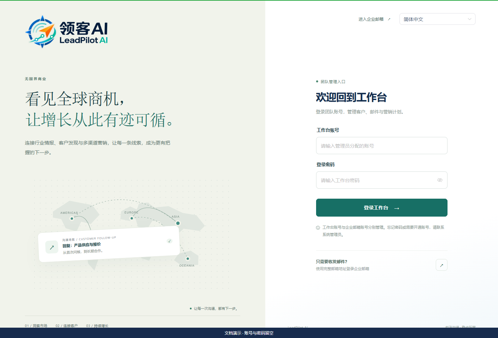

工作区切换会保持部分页面状态，但未保存编辑不应视为已写入数据库。浏览器刷新、页面刷新和任务执行是不同操作。

## 3. 部门、成员与角色（管理员）

### 3.1 建立组织

进入 **部门工作台 → 部门**：新增名称，选择父部门，设置启用状态，保存。先建立部门树，再创建成员，避免历史数据归属不清。

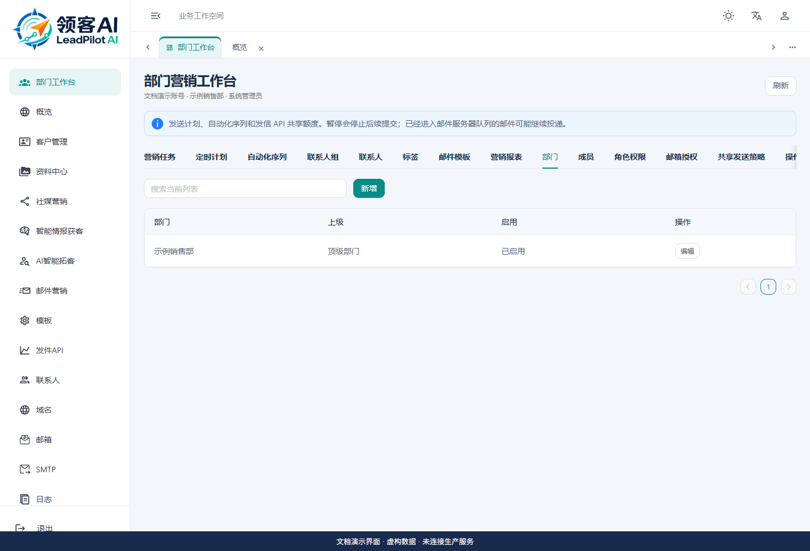

### 3.2 配置角色和数据范围

进入工作台的角色管理标签，设置角色名、操作权限和数据范围。推荐先选最小范围，确认业务确需后再扩权。

- 本人：仅允许范围内本人记录。
- 本部门 / 本部门及下级：按部门树限制。
- 指定部门：显式选择授权部门。
- 全部：不等于系统管理员，也不自动拥有全部邮箱/主页权限。

创建、编辑、删除、导入、导出、发布和设置属于不同操作，不能只勾选“查看”后期待可以发布。

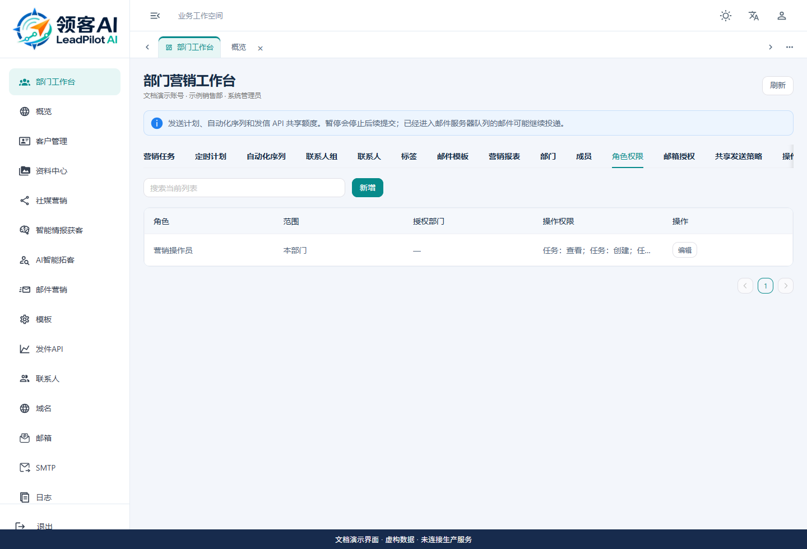

### 3.3 成员、邮箱授权和发送策略

1. 新建成员时选择部门和角色，设置个人初始密码；不要在公开手册记录真实密码。
2. 在邮箱授权中为部门配置允许使用的发件邮箱。角色发送权限与邮箱授权必须同时满足。
3. 在发送策略中配置系统、部门、邮箱、IP或服务商限制：分钟/小时/24 小时额度、间隔、并发、时区窗口和客户冷却。
4. 使用普通成员账号核对列表、导出、文件下载和发送范围。撤销授权后也要检查后台任务停止条件。

停用成员或部门不等于删除历史记录。员工调部门不会自动迁移全部历史业务数据，旧任务可能因归属不匹配停止。

## 4. 域名、邮箱和收发基础

### 4.1 域名

进入 **域名**，维护业务域名、主机名、邮箱额度和相关设置。按系统生成的记录核对 MX、A、SPF、DKIM、DMARC，并由运维人员确认 PTR/出口 IP 和服务商出站 SMTP 政策。

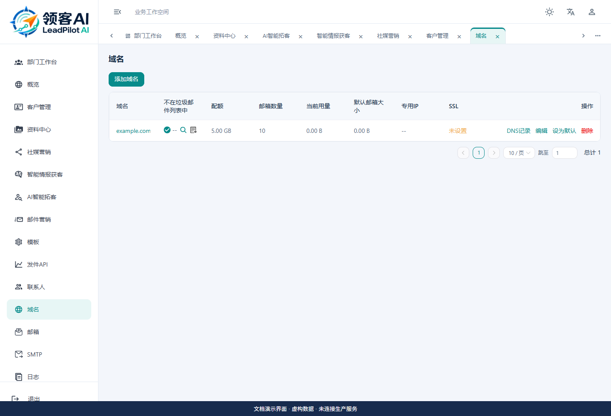

生产建议仅一个有效 SPF 记录，正确签名并验证 DMARC 对齐。不要在尚未验证投递的情况下盲目提高限制。SSL 私钥属于私有配置，不上传 GitHub。

### 4.2 邮箱

进入 **邮箱**，选择域名，新增单个或批量邮箱，设置容量、状态和密码。

- 前端不再预填固定密码；新增单个或批量邮箱时需要输入符合界面规则的密码。
- 后端空密码请求只有在私有环境配置了有效 `DEFAULT_NEW_MAILBOX_PASSWORD` 时才可回退；未配置会拒绝创建。
- 修改既有邮箱时留空密码表示保留现有密码，不应为了更新名称重置邮箱凭据。
- 独立邮箱账号不自动等于管理台账号；Webmail 使用邮箱认证。

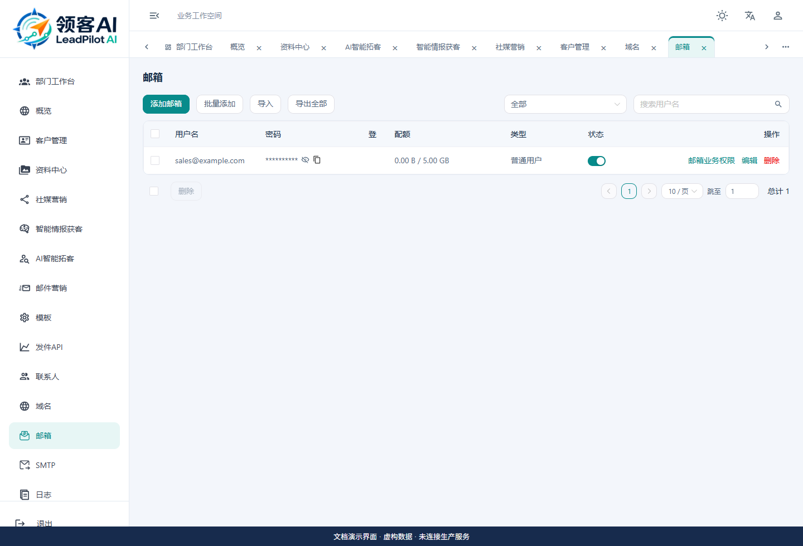

首次测试使用自己控制的邮箱，验证 SMTP 提交、最终到达、IMAP/Webmail 收件和回复。应用显示 accepted 不等于目标邮箱已经收件。

## 5. AI 模型服务和预算

进入 **设置 → AI 模型服务**；社媒/拓客模块也提供相关设置入口，实际模型选择由统一注册中心管理。

1. 新增服务商，选择实际支持的协议（Responses 或 Chat Completions），填写正确 HTTPS 基础地址。
2. 在私有管理界面填写密钥；不在手册、聊天、GitHub 或截图中公开。
3. 添加/发现模型，核对模型 ID、启用状态、文字/对话/视觉/图片生成/Embedding 能力和输出上限。
4. 按能力选择默认模型，设置每日调用与 Token 预算，保存。
5. 使用系统提供的测试入口或受控任务做一次最小验证，确认协议、模型和额度；保存成功不是联网测试成功。
6. 更换端点时按界面要求重新提供密钥，防止把原凭据发送给错误服务。

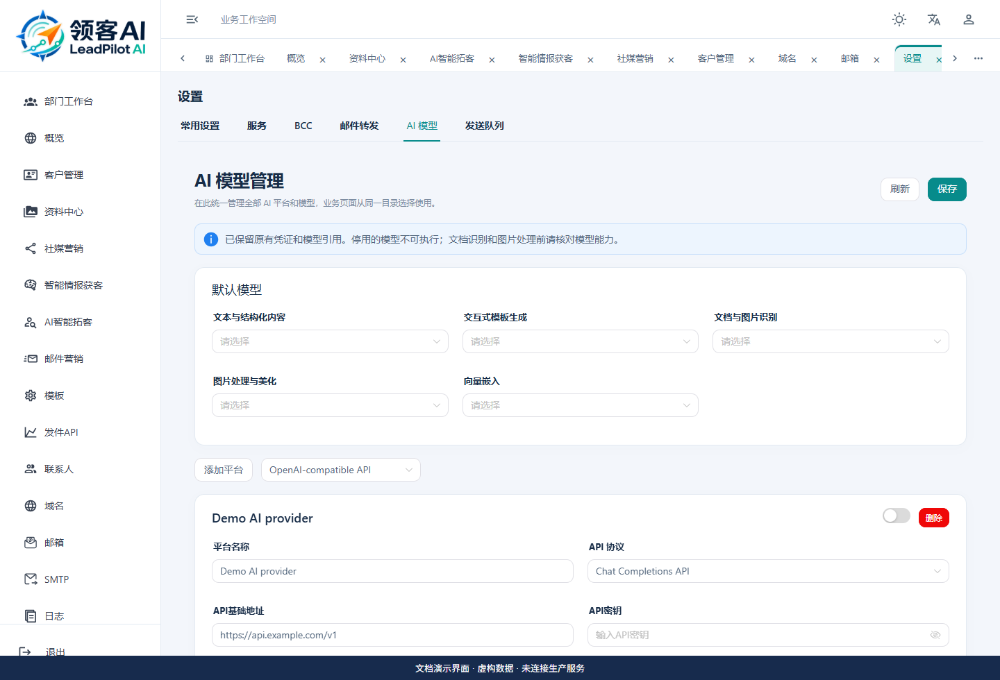

视觉、PDF 输入、图片生成和联网搜索是不同能力。不要将仅支持对话的模型用于直接 PDF 识别。供应商声明、系统选项和真实调用能力需分别核对。

## 6. 公司、产品和资料中心

进入 **资料中心**，先选择公司，或创建公司草稿。录入品牌、域名、产品/服务和可证实的业务事实。

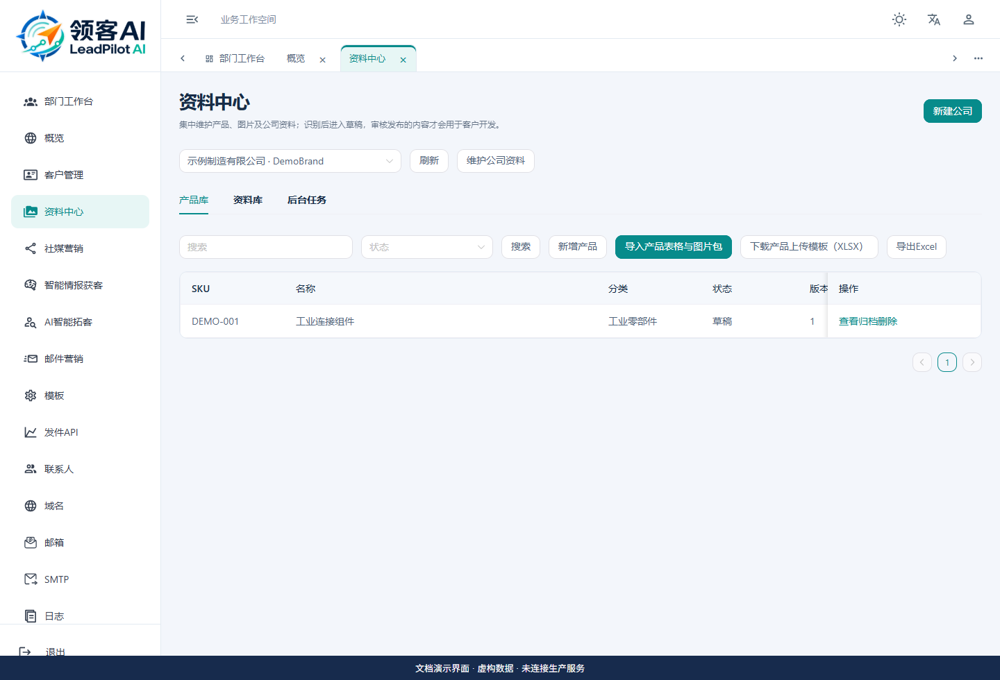

### 6.1 公司事实和发布

保存草稿后检查名称、业务范围、联系方式、服务承诺和证据。只有经过审核、明确发布的对外资料才应供自动营销使用。共享部门只能按授权读取已发布资料，内部文件不可自动变成公开内容。

### 6.2 产品表格与图片

1. 下载当前版本的产品/行业模板，按字段填写。
2. 上传 XLSX 并检查全部工作表、原行号、SKU 前导零和列映射。
3. 对缺失编号、字段冲突、图片归属歧义等待复核行进行人工确认。
4. 已有人工作过的字段不应被再次导入自动覆盖；核对实际更新结果。
5. 上传/关联产品图片，确认主图与相关图片角色，复核后发布产品。

ZIP 内的路径不能穿越目录，也不能放入私钥、数据库备份或敏感业务资料。公司资料、产品导入和社媒任务上传的格式/大小限制不同，以当前界面和后端配置为准，不混用一个统一上限。

### 6.3 AI 识别和版本

上传 PDF、Office 文件或图片后，按需要允许 AI 识别并选择模型。先看抽取事实、证据位置和不确定项，再人工合并到草稿。成本、银行、凭据、内部采购等字段不得进入对外内容。发布后保留版本；资料变更可能使未发送开发信的旧快照失效。

## 7. 联系人、分组和导入

普通业务人员可在工作台的联系人组、联系人和标签中操作；管理员也可能看到独立“联系人”页面。

1. 建立清晰的部门联系人组，填写说明。
2. 使用该页面当前接受的导入格式；先预览字段与地址，填写过滤词，确认去重与待复核情况。
3. 区分地址验证、启用、订阅和确认状态。导入发现的公开邮箱不自动具备商业营销许可。
4. **导入为已确认联系人可能触发已启用的订阅自动化**；不确定时先关闭相关自动化并检查状态。
5. 给联系人添加标签。营销受众可按 AND/OR/NOT 等逻辑筛选；发布前核对最终预览，而非仅核对分组总数。
6. 导出需要独立权限；导出文件按内部数据处理规则保存，不放入公共仓库。

## 8. 邮件模板、草稿和发送

### 8.1 模板准备

在模板菜单或工作台模板标签新增模板，编辑 HTML 或使用 AI 辅助。预览布局、链接、品牌、纯文本/富文本效果和退订信息。合并变量按该页面模板语法使用，不直接从本手册猜测变量名。

### 8.2 创建任务

进入 **部门工作台 → 营销任务**，点击新建：

1. 填写名称和主题；选择联系人组、标签条件、模板和发件邮箱池。
2. 核对发件人显示名、回复/抄送设置、打开/点击跟踪和退订。
3. 设置间隔、并发、滚动额度、批次数量、休息、时区窗口和客户冷却；0 不绕过上层限制。
4. 预览受众与内容，保存草稿；由有权限人员审核后发布。
5. 首次只用内部受控目标试发，核对最终收件而不只看提交计数。

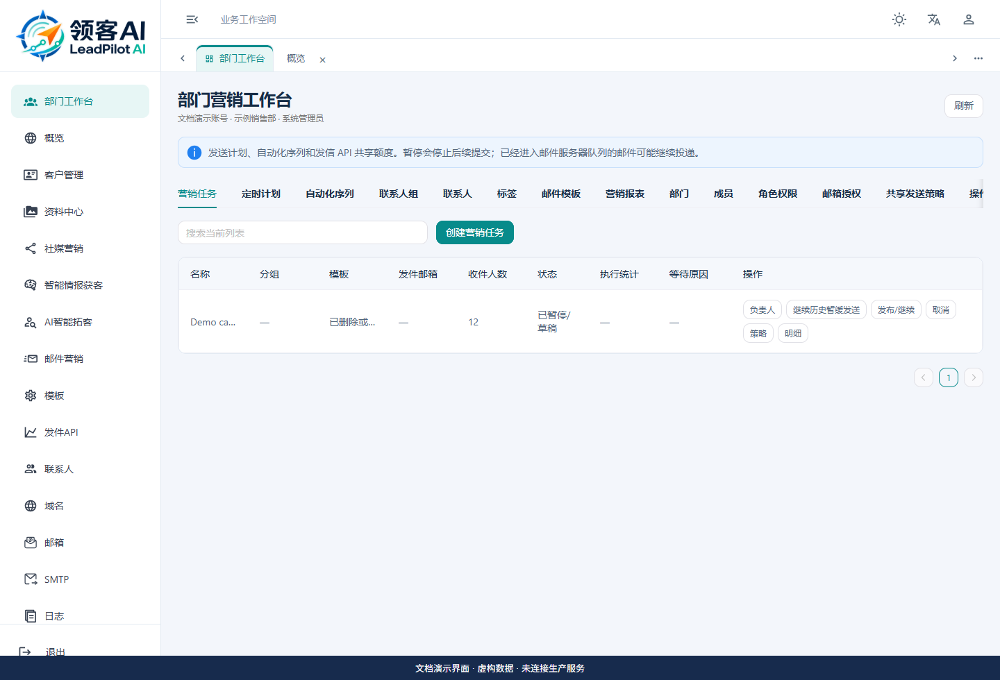

### 8.3 执行、暂停和结果

- 暂停/取消只停止后续交接，已在邮件服务器队列中的邮件可能继续发送。
- 额度、时间窗、权限或客户冷却阻塞时，先查看具体原因，不提高并发掩盖问题。
- `unknown` 表示无法确认是否提交，管理员应先核对邮件队列和日志，不直接再次发送。
- 打开和点击是观测信号，受隐私代理和扫描器影响；不能作为可靠合同签收证据。

### 8.4 计划与订阅自动化

一次/每日/每周/每月计划按指定时区运行，每次生成独立任务。月底日期和夏令时需要核对；停机后不会集中补发所有历史周期。

订阅自动化是有序步骤：等待、始终发送、前一封已打开、已点击或未打开。规则修改影响新的加入实例；已有实例保留快照。先使用测试联系人验证，再启用真实业务规则。

## 9. AI 智能拓客

进入 **AI 智能拓客**，先维护并发布公司/产品资料。

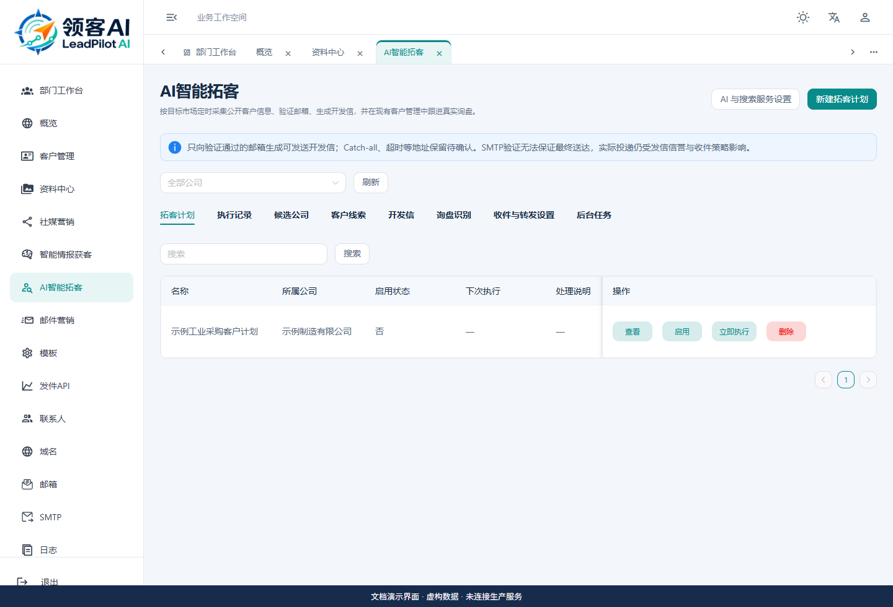

1. 新建计划，选公司和产品/服务；选择国家、语言、时区和目标客户要求。
2. 配置搜索词、网站数量、每日新增/发信额度、邮箱过滤、发件箱池、发送窗口与冷却。
3. 第一次关闭自动发送，先运行小批量发现任务。
4. 查看运行记录与候选公司：检查来源 URL、市场匹配、公开联系证据和验证结果。
5. 无效地址不得进入开发信；无法确认、Catch-all 等结果进入人工复核，不把模型猜测地址当作可用邮箱。
6. 核对生成开发信、来源版本、目标语言、事实和退订，再按权限确认发送。
7. 查看询盘及收件规则；疑似人工回信可暂停后续开发。真实询盘关联 CRM，需要时按已配置规则转发。
8. 仅对尚未进入发送/未知状态的内容按界面规则重新生成；不要用重新生成绕过重复发送保护。

计划变更可能默认暂停。授权撤销、资料更新、退订、客户回信和冷却会影响后续交接。完成发现任务不意味着已经发送或成交。

## 10. 智能情报获客与 Growth Master

进入 **智能情报获客**，选择公司。该模块是行业包、14 项技能和 6 类固定工作流的受控执行台，不是任意节点编排器。

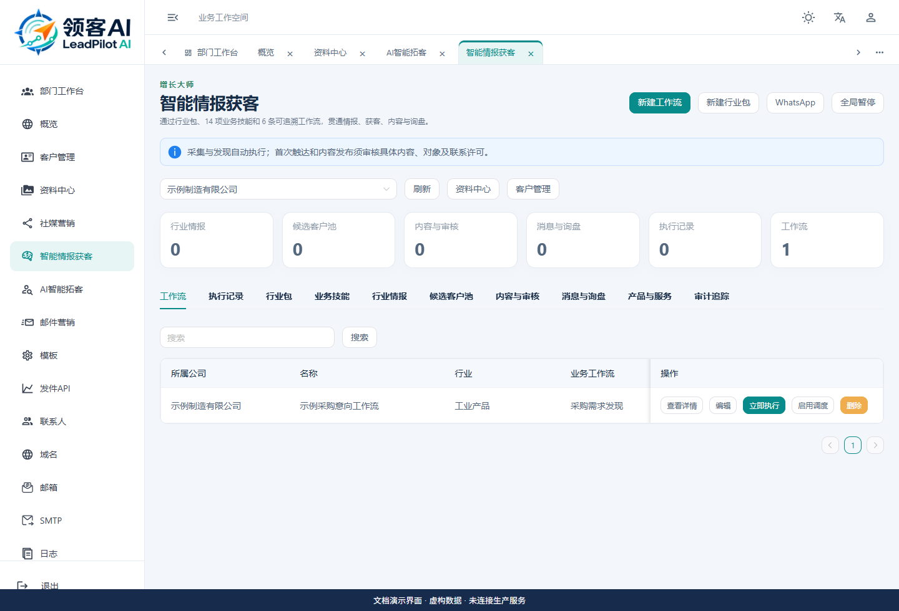

### 10.1 行业包

新建或复制行业包，配置产品/服务类型、术语、买家、意向词、排除词、来源、字段、评分权重、最低分/置信度和禁止声明。系统模板复制后编辑；AI 扩词需要人工勾选确认。

### 10.2 业务技能

在业务技能标签为所需技能选择模型和条数、输出、超时/重试限制。先检查搜索、验证、资料和渠道能力，不要给所有技能无条件打开最大预算。

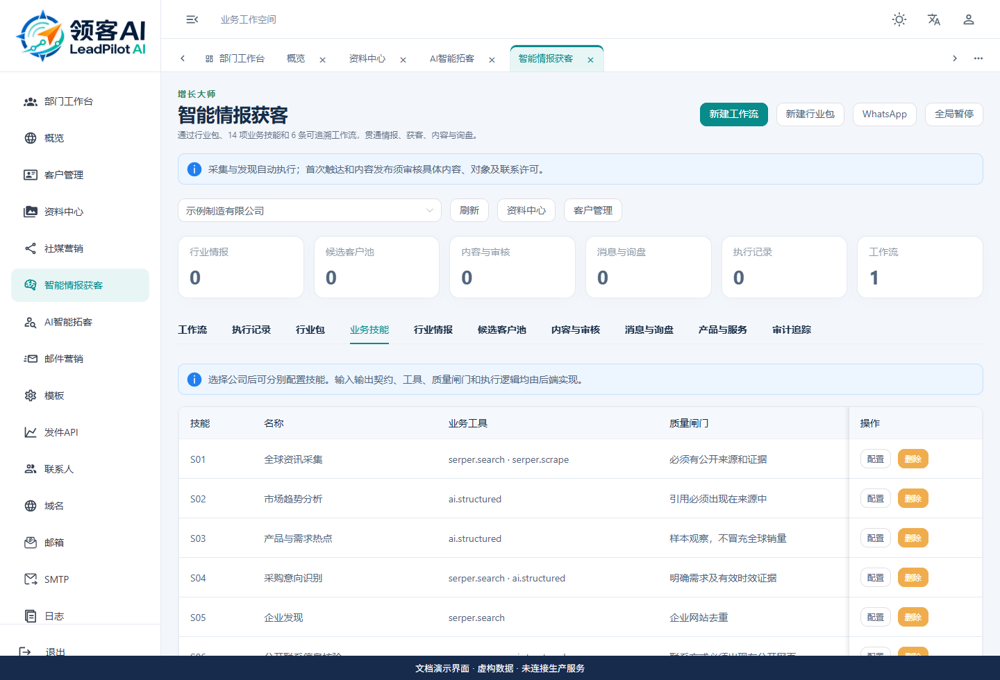

### 10.3 工作流执行

1. 按目的选择 WF01 行业观察、WF02 采购意向、WF03 客户发现、WF04 内容与渠道、WF05 来信处理或 WF06 增长分析。
2. 选择市场、资料、发件箱/主页、质量门槛、周期和调用/Token/搜索/抓取/发送预算。
3. 保存后先手动运行小批量；查看执行记录、检查点、证据、候选评分与失败/等待原因。
4. 内容审批时核对**具体内容、具体目标和冻结版本**。首次触达与公开发布不能由模型自行批准。
5. 若启用受控自动回复规则，必须明确审批规则与允许事实；敏感商业承诺仍由人工处理。普通 CRM AI 回复草稿默认需要人工发送。
6. 遇到待配置、预算耗尽、等待审核或外部结果，解决对应原因再恢复。
7. 管理员紧急暂停用于阻止后续工作，不承诺撤销已外发内容。

## 11. 社媒账号、内容和排期

进入 **社媒营销**。先准备已发布公司资料及官方平台账号授权，再将任务从草稿推进到审核与排期。

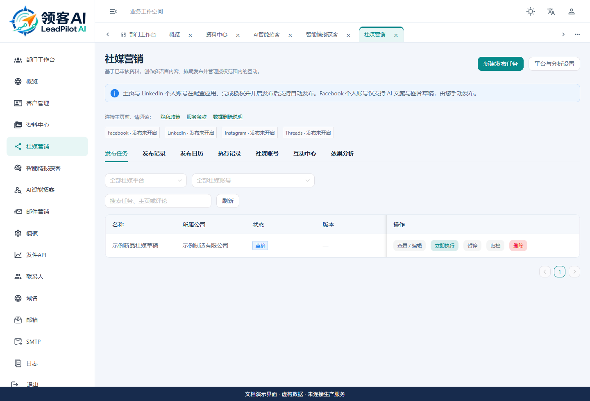

### 11.1 平台与账号

1. 管理员配置官方应用、回调地址、实际获批权限与平台发布开关。
2. 使用官方 OAuth 流程授权，显式选择需要连接的主页/账号；不要把别人提供的 Token 粘进公开文档。
3. 确认所属部门、主页管理能力、授权有效期和发布模式。
4. 授权开关与真实发布开关分开；连接完成不代表已允许自动发帖。

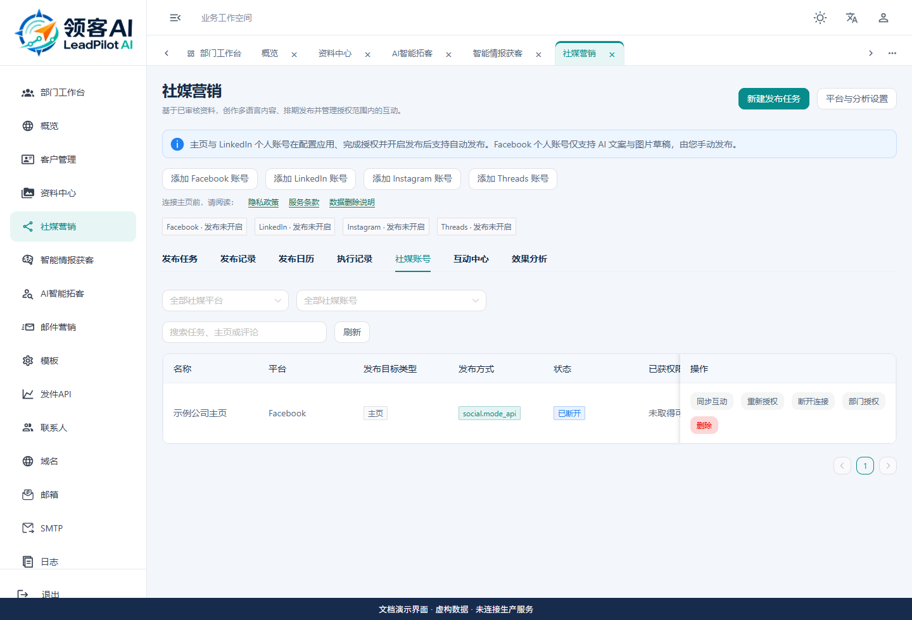

### 11.2 内容版本与人工审核

新建任务，选择公司、平台、国家、语言、账号和当地时间。上传或选择已批准资料，生成/手写各版本正文，预览链接、图片、段落、语言和来源事实。修改版本后重新审核；一个任务的不同市场可以对应多个授权账号。

国家/语言用于本地化，不等于平台广告地域定向。任务专用文件与资料中心发布文件是不同生命周期；归档到资料中心应显式操作。

### 11.3 发布与未知结果

批准后排期，核对时区和夏令时。API 模式由工作进程向获准平台提交；人工模式由操作员到平台实际发布后按界面确认，不能把“人工确认”当作系统自动发布凭证。

结果超时或未知时先核对平台帖子 ID 和归属，不盲目重试。删除任务或发布记录不等于删除平台帖子。平台已撤权或令牌过期时重新授权，不修改记录假装成功。

### 11.4 互动与效果

本地刷新仅读取已保存状态；平台同步才请求新的官方指标。查看采集时间、覆盖数量和 `—`，不要将缺失指标作为零。遵守平台对成员数据、评论、AI 使用及保留期的要求。当前指南不提供自动评论回复、广告或视频发布步骤。

## 12. CRM、询盘和回复

进入 **客户管理**，按部门范围搜索客户、阶段与下一次跟进。

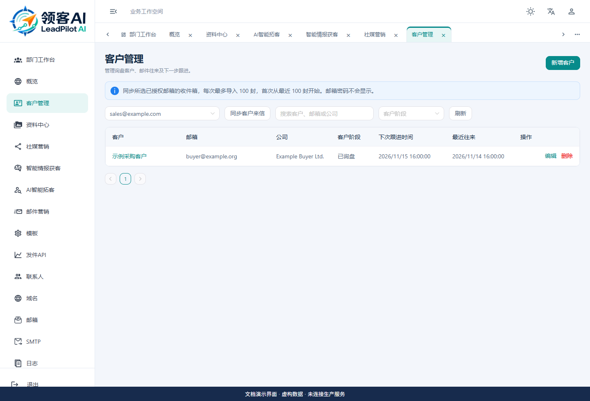

1. 选择授权收件邮箱并同步 INBOX；首次起始范围与增量游标受现有实现限制，不等于完整历史邮件导入。
2. 对询盘、自动回复、退订和不明确消息分别处理；不确定内容先人工确认。
3. 打开正确客户与邮件线程，维护公司、阶段（新客户/询盘/报价/谈判/赢单/丢单等）和下一次跟进。
4. 需要 AI 回复时选择正确公司资料，生成草稿，补齐缺失事实并人工编辑。
5. **核对收件人、发件邮箱、主题、附件和商业承诺后，显式发送。** 草稿生成不是发送动作。
6. 对转发/回复结果为 unknown 的记录先查看邮件日志与客户会话，避免重复提交。

## 13. 统计、报表和日常检查

进入概览，选择域名与时间，结合邮件服务器日志、任务统计、退信、打开/点击覆盖和队列观察。

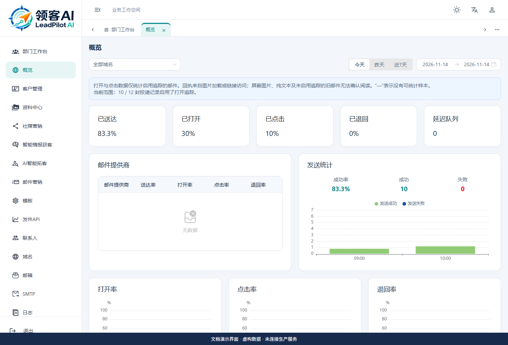

推荐每日检查：未完成任务、unknown、待审批、预算耗尽、授权过期、退信异常、退订处理、客户跟进、磁盘空间及备份。报表导出需要权限，不能把客户明细发布到公共 GitHub。

## 14. 常见问题速查

| 现象 | 先检查 | 不应采取的操作 |
|---|---|---|
| 菜单/按钮不见 | 角色操作权限、数据范围、资源授权、账号状态 | 猜旧接口或绕过前端 |
| 新邮箱创建失败 | 密码规则；空 API 请求的私有默认密码配置 | 恢复硬编码共享密码 |
| AI 模型不可选 | 服务启用、密钥、协议、模型能力和预算 | 把保存成功当作可调用 |
| 线索不发信 | 来源、验证有效期、订阅/抑制、冷却、计划状态 | 强制将未知地址标为有效 |
| 邮件 pending 很久 | 共享额度、窗口、授权、发送日志和队列 | 盲目增并发或重复新建任务 |
| 社媒无法发布 | 应用审批、账号模式、实际权限、审核版本、令牌 | 填写虚假帖子 ID |
| 状态 unknown | 外部平台/SMTP 回执与后台日志 | 未核查就重试 |
| AI 密钥恢复后失效 | 数据库与 `.ai-master-key` 是否配套 | 仅恢复数据库并覆盖主密钥 |
| GitHub 克隆后无法编译 | 私有 SQL、依赖、前端产物与配置是否齐全 | 将私钥/数据库脚本强行提交 |

## 15. 操作完成标准

任何“成功”应说明层级：保存成功、验证通过、入队成功、外部接受、最终投递或业务确认。正式验收至少覆盖权限隔离、受控目标投递、退订、回信、平台授权及 unknown 恢复。截图与本手册不能替代这些验收。
